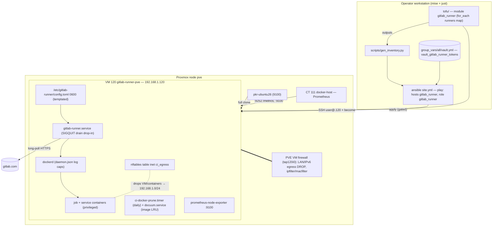
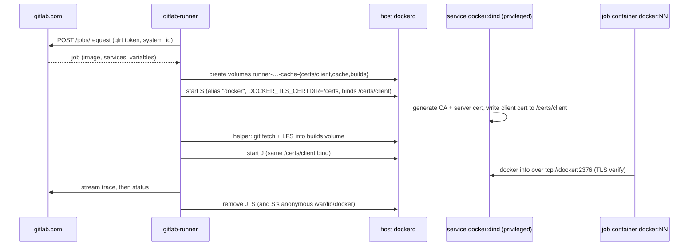

# Detailed Design: Self-hosted GitLab Runner on the Proxmox homelab

Planning date 2026-11-04. Repo base `3f69dcb`. This document stands alone; the research notes in `../research/` hold the sources.

## 1. Overview

GitLab.com CI jobs for any of the operator's projects should run on homelab hardware instead of GitLab's metered instance runners. The first consumer is `lumologic/lumologic`: its pipelines exhausted this month's compute minutes and now fail with `ci_quota_exceeded`.

The deliverable is a general homelab service, managed like the rest of this repo:

- A dedicated **Ubuntu 26.04 VM** (`gitlab-runner-pve`, vmid 120, 192.168.1.120) cloned from the existing Packer template `pkr-ubuntu26` through `tofu/modules/dev_vm`. The node is a variable. A second VM on the other Proxmox node is a map entry plus a provider instance for that cluster (§4.1).
- A new Ansible role, **`gitlab_runner`**, that does the following:
  - installs Docker Engine (via the vendored `geerlingguy.docker`) and gitlab-runner from their official apt repos;
  - renders `/etc/gitlab-runner/config.toml` from a template, never hand-edited and never `register`ed;
  - drains running jobs before any package upgrade;
  - evicts cached images least-recently-used first above a disk threshold (Docuum), and prunes the rest of Docker daily;
  - fences CI jobs off the LAN with nftables (an accident guard);
  - grants privileged mode only to `docker:*-dind` services.
  - ships a DinD-TLS smoke test.
- A **Proxmox VM firewall** managed from tofu: an egress block plus anti-spoofing that root inside the VM cannot undo (Q8). It is its own gated step.
- Monitoring, as the final step: a node-exporter and runner metrics scraped by docker-host's Prometheus, with the VM covered by the existing disk alerts.
- A runbook, `docs/runbooks/gitlab-runner.md`.

The runner polls gitlab.com over outbound HTTPS and needs no inbound ports, apart from SSH for Ansible and the metrics scrape from docker-host.

## 2. Detailed Requirements

Consolidated from `rough-idea.md` and `idea-honing.md` Q1–Q7, plus the defaults accepted at the end of Q&A.

### 2.1 Capabilities the runner must support (general, not lumologic-specific)
- **R1. Docker executor.** Each job names its own image (e.g. `python:3.14-slim`, `node:24`, `docker:27`, `mcr.microsoft.com/playwright:v1.59.1-noble`) and may use service containers (`postgres:16`, `redis:8.6`).
- **R2. Privileged mode**, so `docker:*-dind` with TLS works: `DOCKER_HOST=tcp://docker:2376`, client certs in `/certs/client`.
- **R3. Untagged jobs** are accepted. This is set on the GitLab side, at runner creation.
- **R4. Load.** Up to 3 concurrent jobs per pipeline, 50-minute jobs with 90-minute timeouts, and about 360 MB of Git LFS per clone. `concurrent = 4`.

### 2.2 Infrastructure
- **R5.** It is a VM, not an LXC. It is built from `pkr-ubuntu26` through `tofu/modules/dev_vm` and configured by an Ansible role in the repo's existing style.
- **R6.** The size is set by variables: 8 vCPU, 16 GB RAM, 150 GB disk.
- **R7.** The node is a variable. The first VM goes on `pve`; a second node is one more entry. Its details will be asked for when needed.
- **R8 (Q1).** `dev_vm` gains optional `ssh_public_keys` and a static IPv4 (`ipv4_cidr`, `gateway`) plus DNS. All default to empty or DHCP, so existing dev-VM behaviour is unchanged. `test_no_consumer_cidata_variables` is polarity-flipped to "optional, empty by default" in the same commit. The provider pin moves from `~> 0.104.0` to `>= 0.108.0`.
- **R9 (Q2).** The first VM is vmid **120** at **192.168.1.120/24** on `pve`. The operator confirms the address is free and outside the DHCP pool. A second-node runner later takes 121 / .121.

### 2.3 Software and configuration
- **R10.** Docker Engine and gitlab-runner come from their official apt repositories. `gitlab-runner` and `gitlab-runner-helper-images` stay on the same version.
- **R11.** `config.toml` is rendered from a template (mode 0600, root) and never hand-edited. It contains:
  - the `docker` executor with `privileged = false`, `services_privileged = true`, `allowed_privileged_services = ["docker:*-dind"]` (Q8). Only the dind service is privileged; job containers are not. `disable_entrypoint_overwrite` is deliberately **not** set (review): it also applies to job containers, so it would silently ignore the common `image: {entrypoint: [""]}` override and break R1;
  - feature flags `FF_NETWORK_PER_BUILD = true` and `FF_ENABLE_JOB_CLEANUP = true`;
  - `volumes = ["/certs/client", "/cache"]` with **no host binds**;
  - `pull_policy = ["if-not-present"]`;
  - a small pinned default image (`alpine:3.22`);
  - global `concurrent` (default 4) and per-runner `limit` (default 0, meaning it shares the global cap);
  - `request_concurrency` (default 2);
  - `shm_size` of 2 GiB, for Playwright;
  - metrics on `listen_address = "<vm ip>:9252"`.
- **R12. Registration** uses the current authentication-token flow only. The operator creates each `glrt-` token in the GitLab UI or API, and it lives in the Ansible vault. The playbook **never calls `gitlab-runner register`**, so re-runs can't create duplicates. There is a list of runners, so adding a project is a vars change plus a vault entry.
- **R13.** With no runners declared (before any token exists) the role still converges: Docker and gitlab-runner are installed and the config is rendered with zero `[[runners]]`. Nothing token-dependent runs.
- **R14.** Container logs are bounded at 10 MB × 3 per container, matching docker-host.

### 2.4 Upkeep
- **R15 (Q6, revised in review).** Two mechanisms:
  - **Images: Docuum** (a pinned release binary run as a systemd service) evicts images least-recently-used first once image storage passes `gitlab_runner_docuum_threshold` (default `60%`). `--min-age` protects anything used recently. Docker's own `image prune --filter until=` counts from the upstream *build* date, so it would have deleted most images nightly and forced re-pulls against the shared Docker Hub anonymous limit.
  - **Everything else: a daily systemd timer**:
  - stopped containers, build cache and networks older than **7 days** (`until=168h`, a variable), plus dangling images;
  - runner-managed volumes not in use (`label=com.gitlab.gitlab-runner.managed=true`);
  - anonymous dangling volumes.
- **R16 (Q5).** Upgrades go through the normal playbook run. When `gitlab-runner`, `gitlab-runner-helper-images`, `docker-ce`, `docker-ce-cli` or `containerd.io` has an upgrade pending, the play **drains**: a graceful stop waits for running jobs. Then it upgrades and starts the runner. A run can block for up to about 90 minutes; no job is killed. If nothing is pending, nothing restarts.
- **R17 (Q4).** Monitoring is the **final** plan step, behind its own operator gate because it changes CT 111:
  - a node-exporter on the VM;
  - Prometheus scrape jobs for runner metrics and node metrics;
  - the VM covered by the `host-disk` alerts, including an `absent()` arm.

### 2.5 Isolation and security
- **R18.** No bind mounts and no shared credentials from other homelab services. Nothing goes on the VM that a CI job should not read: only the runner tokens and the operator's *public* key.
- **R19 (Q7).** In-VM nftables drop egress from the VM and all containers to `192.168.1.0/24`, except DNS to the gateway `192.168.1.1`.
  - Inbound SSH is still allowed from the LAN.
  - Ports 9100 and 9252 are allowed from `192.168.1.111` only.
  - Return traffic for established connections is allowed.
  - IPv6 is off in the guest, and the table drops all IPv6 egress, so it cannot bypass the IPv4 rules (Q8).
  - Documented limitation: root on the VM (reachable deliberately through the privileged dind service) can flush these rules. This layer is the accident guard; R24 is the enforcement layer.
- **R20.** The template's weak credentials are retired: password SSH is off and the `user` account password is locked.
  - `common`'s `lineinfile` on `/etc/ssh/sshd_config` is **not enough on this template**. The Packer seed's `ssh_pwauth: true` left `/etc/ssh/sshd_config.d/50-cloud-init.conf` (`PasswordAuthentication yes`), and `cloud-init clean` doesn't remove it. Ubuntu's `sshd_config` `Include`s that directory at the top, and sshd takes the first value it reads, so the drop-in wins. The role writes `/etc/ssh/sshd_config.d/00-homelab-hardening.conf` (`PasswordAuthentication no`, `KbdInteractiveAuthentication no`) and removes `50-cloud-init.conf`.
  - Proof is live: `sshd -T | grep -i passwordauthentication` prints `no`, and a password login is refused.
  - Any tofu change to the cloud-init inputs (keys, DNS) gives the VM a new instance-id. cloud-init then re-runs its per-instance modules, which may rewrite `50-cloud-init.conf` and regenerate host keys. The `00-` drop-in still wins, and the next play removes the file again. The runbook notes the host-key change.
- **R28 (review). needrestart.** If Ubuntu's `needrestart` is installed, a drop-in in `/etc/needrestart/conf.d/` excludes `docker.service`, `containerd.service` and `gitlab-runner.service`. Otherwise unattended library upgrades from `common` could restart dockerd and kill jobs, bypassing R16's drain.
- **R24 (Q8). Proxmox VM firewall**, managed from tofu, is the enforcement layer, because root in the guest cannot change it.
  - Egress: DNS to `.1` is allowed. Everything else to RFC1918 (any subnet the router routes, not just `192.168.1.0/24`), `100.64.0.0/10`, multicast and broadcast is dropped. All IPv6 out is dropped. Docker's internal `172.x` bridges never reach the tap, so this doesn't affect jobs. The in-VM table keeps `192.168.1.0/24`, because a `172.16.0.0/12` drop there would break Docker's own bridges.
  - Ingress: policy DROP. SSH is allowed from the LAN, and 9100/9252 from `.111` only.
  - Anti-spoofing: `macfilter` on, `ipfilter` on with an explicit `ipfilter-net0` set holding the VM's IP, `radv = false`, `dhcp = false`, `ndp = false`.
  - The datacenter switch is set with `input_policy = "ACCEPT"` and the `pve` node firewall is disabled, so `pve`'s own and other guests' traffic is unaffected.
  - It is enabled through the lockout-safe sequence in §4.10, behind its own operator gate.
- **R25 (Q8). WAN-IP hairpin check.** Measure from the VM whether a connection to the router's public IP reaches Traefik's internal-only routers; the `internal-allowlist` admits `192.168.1.0/24`. If it does, close it (options in §4.10). This is a gated live measurement.
- **R26 (Q8). GitLab-side hygiene**, done by the operator and documented in the runbook:
  - each runner is **locked** to its project;
  - "run pipelines for fork MRs in the parent project" is off (`ci_allow_fork_pipelines_to_run_in_parent_project = false`);
  - the maximum job timeout is **set** to 5400–5700 s. It must stay below the drain timeout (`gitlab_runner_drain_timeout_sec`, 6000), less time for `after_script` and artifact upload, or a drain SIGKILLs the job;
  - the CI job-token allowlist stays at its default.
- **R27 (Q8). Runbook security model:**
  - "Developer or above on any attached project means root on the runner VM and all its tokens."
  - A compromise playbook: pause the runner, re-image the VM, delete and recreate the runner (or use the ID-based reset; never the token-based reset). Reset any CI variables the runner could have seen.
  - Routine re-image monthly and on upgrades.

### 2.6 Process constraints
- **R21.** Every step is verified with `just test`, `just fmt` and `tofu plan` before moving on.
- **R22. Operator gates.** Stop and ask before `tofu apply`, `just provision`, any playbook run against a live host, and anything that needs a GitLab token.
- **R23.** Out of scope:
  - the fleeting-plugin-proxmox repo and any autoscaling;
  - any change to a GitLab project's CI config or settings. The operator turns off instance runners and retries pipelines.

### 2.7 Done when
- **D1.** The VM exists. Two consecutive playbook runs succeed and the second reports `changed=0`. `gitlab-runner verify` passes.
- **D2.** The on-VM smoke test passes. It starts a dind daemon and a client sharing `/certs/client`, runs `docker info` over `tcp://docker:2376` with TLS verified, and includes the negative controls. The tag is a variable, defaulting to the current stable line (29); see Q3.
- **D3.** The runner shows online in `lumologic/lumologic` → Settings → CI/CD → Runners.
- **D4.** `docs/runbooks/gitlab-runner.md` covers creating and registering a runner, adding a project, rotating a token, upgrading, cleaning disk, and troubleshooting an offline or stuck runner.
- **D5.** The final handoff message lists the operator's GitLab actions:
  - create the token;
  - turn off instance runners for the project;
  - retry the failed lumologic pipeline and confirm its jobs ran on this runner.
- **D6 (Q8).** The PVE firewall is on with the §4.10 verification list passing, including the `nft flush ruleset` negative control. The hairpin is measured, and either closed or explicitly accepted in the runbook.

## 3. Architecture Overview



### Job data flow (DinD case)



## 4. Components and Interfaces

### 4.1 Tofu

**`tofu/modules/dev_vm`** (extended; R8):

| Variable | Type / default | Effect |
|---|---|---|
| `ssh_public_keys` | `list(string)`, `[]` | When non-empty, renders `initialization.user_account { username = var.ssh_username, keys = … }` |
| `ssh_username` | `string`, `"user"` | The template's baked-in user |
| `ipv4_cidr` | `string`, `""` | Empty means `dhcp`; otherwise a static `address` |
| `ipv4_gateway` | `string`, `""` | Required when `ipv4_cidr` is set (validation) |
| `dns_servers`, `dns_domain` | `list(string)` `[]`, `string` `""` | Rendered as an `initialization.dns` block only when set |
| `vm_id` | `number`, `null` | A stable vmid; null lets PVE pick, which is the current behaviour |
| `firewall` | `bool`, `false` | Sets `network_device.firewall`. The runner passes `true` (R24) |
| `cpu_type` | `string`, `"host"` | Pinned explicitly. The template uses `host`, but bpg's schema default is `qemu64` |

- `versions.tf` moves to `>= 0.108.0`.
- Outputs gain `ipv4_configured` (the static address without its prefix, or null). It is deterministic, unlike the agent-reported `ipv4_address`.

**Root** (`tofu/locals.tf`, `main.tf`, `outputs.tf`):

```hcl
# locals.tf
gitlab_runners = {
  "gitlab-runner-pve" = {
    node      = "pve"
    vm_id     = 120
    ip_cidr   = "192.168.1.120/24"
    cores     = 8
    memory_mb = 16384
    disk_gb   = 150
  }
}
```

```hcl
# main.tf
module "gitlab_runner" {
  for_each        = local.gitlab_runners
  source          = "./modules/dev_vm"
  name            = each.key
  os              = "ubuntu26"
  template_id     = local.template_ids.ubuntu26
  node            = each.value.node
  vm_id           = each.value.vm_id
  cores           = each.value.cores
  memory_mb       = each.value.memory_mb
  disk_gb         = each.value.disk_gb
  ipv4_cidr       = each.value.ip_cidr
  ipv4_gateway    = local.net.gateway
  dns_servers     = local.net.dns_servers
  dns_domain      = local.net.dns_domain
  ssh_public_keys = local.operator_ssh_keys
  firewall        = true # inert until the VM's own firewall options are enabled (§4.10)
}
```

```hcl
# outputs.tf
output "gitlab_runners" {
  value = { for k, m in module.gitlab_runner : k => { ipv4 = m.ipv4_configured, vm_id = m.vm_id } }
}
```

`local.operator_ssh_keys` **already exists** (`tofu/locals.tf`), built from `var.operator_ssh_public_keys` and `var.operator_ssh_public_key_file`, and both default to empty. It holds **public** keys only, the only credential cloud-init puts on the VM (R18). Because an empty list would boot the VM with only the template's `user`/`password`, the runner module call carries a `precondition`/validation that it is non-empty.

**Second-node caveat:** the template `pkr-ubuntu26` and `template_ids` exist only on `pve`. A second node needs its own template, and possibly a per-node template ID and datastore, before an entry for it can be added. These are the "details of the second node" to ask for later.
- **Provider per node.** §4.10 says the second node is a separate standalone cluster, so it needs its own provider configuration. A `for_each` module can't normally vary its provider per instance, but OpenTofu ≥ 1.9 (the repo pins 1.12.2) can: `provider "proxmox" { alias = "by_node"; for_each = … }` with `providers = { proxmox = proxmox.by_node[each.value.node] }`. A caveat: an entry and its provider instance can't be removed in the same apply. Until then a single default provider is enough, so the first step doesn't use the pattern.

### 4.2 Inventory and recipes
- `scripts/gen_inventory.py` renders a `gitlab_runner` group from the `gitlab_runners` output. Each host gets `ansible_host` (the configured IP), `ansible_user: user` and `ansible_become: true`. It still has no live-IP dependency, because the address is static.
- `justfile`:
  - `play-runner` runs `ansible-playbook site.yml --limit gitlab_runner`, so iterations never touch CT 110 or CT 111.
  - `runner-smoke [TAG]` runs the on-VM smoke script over SSH via an ad-hoc `ansible -m command`. The tag defaults to `gitlab_runner_smoke_tag` (29). D2's brief names `docker:27`, so the gated demo runs both 29 and 27.
  - `play-docker-host` runs `ansible-playbook site.yml --limit docker_host`. Steps that change CT 111 use it, never `just play`, which also deploys CT 110.
  - `runner-reimage NAME` runs `tofu apply` with `-replace` for the VM and that runner's firewall objects (§4.10).
- **Inventory fallback.** As for CT 110/111 (`gen_inventory.py`'s static fallback IPs), the `gitlab_runner` group renders from the static IPs in the tofu config when the output isn't there yet, so committed `hosts.yml` and its guards don't depend on the first apply.

### 4.3 Ansible role `gitlab_runner`

Layout:

```
roles/gitlab_runner/
  defaults/main.yml
  meta/main.yml            # dependency: geerlingguy.docker (docker_packages_state: present, docker_daemon_options: {}, docker_restart_handler_state: started, docker_users: [])
  templates/daemon.json.j2 # log caps; changes go through the drain handler
  tasks/main.yml           # imports the files below in order
  tasks/harden.yml         # lock `user` password; sshd_config.d override + remove 50-cloud-init.conf (R20); needrestart exclusions (R28)
  tasks/firewall.yml       # nftables ci_egress
  tasks/install.yml        # gitlab-runner apt repo + packages; systemd drain drop-in
  tasks/upgrade.yml        # drain-gated upgrade of the five packages
  tasks/config.yml         # config.toml render + verify
  tasks/prune.yml          # prune script + service + timer; docuum binary (pinned, sha256) + unit
  tasks/smoke.yml          # install /usr/local/sbin/dind-tls-smoke (not run by the play)
  templates/config.toml.j2
  templates/ci-egress.nft.j2
  templates/ci-docker-prune.sh.j2
  templates/docuum.service.j2
  templates/dind-tls-smoke.sh.j2   # tag defaults to gitlab_runner_smoke_tag
  files/gitlab-runner-drain.conf
  handlers/main.yml        # Restart gitlab-runner (drains), Drain and restart docker, Reload ci-egress, daemon-reload
```

`site.yml` gets a play after `common`: `hosts: gitlab_runner`, `become: true`, `roles: [gitlab_runner]`. `common` already runs on `all`, which gives base packages, unattended-upgrades, timezone and sshd hardening. Its meta platforms list gains Ubuntu.

**Key variables** (`defaults/main.yml`; runner list in `group_vars/gitlab_runner/vars.yml`):

```yaml
gitlab_runner_url: https://gitlab.com
gitlab_runner_concurrent: 4
gitlab_runner_check_interval: 3
gitlab_runner_listen_port: 9252
gitlab_runner_default_image: alpine:3.22
gitlab_runner_shm_size: 2147483648
gitlab_runner_request_concurrency: 2
gitlab_runner_volumes: ["/certs/client", "/cache"]
gitlab_runner_privileged_services: ["docker:*-dind"]   # matched against the name as the job writes it
gitlab_runner_pull_policy: ["if-not-present"]
gitlab_runner_allowed_pull_policies: ["always", "if-not-present"]
gitlab_runner_drain_timeout_sec: 6000        # > 90-min job timeout + margin
gitlab_runner_prune_keep: 168h
gitlab_runner_prune_on_calendar: "*-*-* 04:00:00"
gitlab_runner_docuum_version: "0.27.3"      # exact pin
gitlab_runner_docuum_sha256: "<from the release>"
gitlab_runner_docuum_threshold: "60%"
gitlab_runner_docuum_min_age: "1d"
gitlab_runner_smoke_tag: "29"
gitlab_runner_lan_cidr: 192.168.1.0/24
gitlab_runner_lan_gateway: 192.168.1.1
gitlab_runner_metrics_allowed_from: ["192.168.1.111"]
gitlab_runner_runners: []                    # see §5.1
```

**Interfaces with the outside:**

| Interface | Direction | Notes |
|---|---|---|
| gitlab.com `/api/v4/jobs/request`, `/runners/verify` | VM → internet, 443 | The token authenticates. No inbound connection |
| Registries (Docker Hub, mcr.microsoft.com, registry.gitlab.com helper) | VM → internet, 443 | `if-not-present` limits pulls |
| SSH | LAN → VM :22 | Ansible as `user` with become |
| Metrics | .111 → VM :9252, :9100 | Allowed only from .111, by the PVE firewall and by nftables |

### 4.4 config.toml template (shape)

```toml
# {{ ansible_managed }} — rendered by roles/gitlab_runner; do not edit
concurrent = {{ gitlab_runner_concurrent }}
check_interval = {{ gitlab_runner_check_interval }}
listen_address = "{{ ansible_host }}:{{ gitlab_runner_listen_port }}"
shutdown_timeout = 30


[[runners]]
  name = "{{ r.name }}"
  url = "{{ gitlab_runner_url }}"
  id = {{ r.id }}
  token = "{{ vault_gitlab_runner_tokens[r.name] }}"
  executor = "docker"
  limit = {{ r.limit | default(0) }}
  request_concurrency = {{ gitlab_runner_request_concurrency }}
  [runners.feature_flags]
    FF_NETWORK_PER_BUILD = true
    FF_ENABLE_JOB_CLEANUP = true
  [runners.docker]
    image = "{{ gitlab_runner_default_image }}"
    privileged = false
    services_privileged = true
    allowed_privileged_services = {{ gitlab_runner_privileged_services | to_json }}
    volumes = {{ gitlab_runner_volumes | to_json }}
    pull_policy = {{ gitlab_runner_pull_policy | to_json }}
    allowed_pull_policies = {{ gitlab_runner_allowed_pull_policies | to_json }}
    shm_size = {{ gitlab_runner_shm_size }}
    disable_cache = false

```

- `token_obtained_at` and `token_expires_at` are deliberately omitted. A zero expiry means the runner never self-rotates or rewrites the file, so Ansible stays the only writer.
- `gitlab_runner_runners_here` is the runner list filtered to the current host (§5.1).
- The privilege split, verified in runner source:
  - A service is privileged only when `services_privileged` is true and its name, **as written in `.gitlab-ci.yml`**, matches `allowed_privileged_services` (doublestar match; `*` does not cross `/`). `docker:*-dind` matches `docker:27-dind`, but a job writing `docker.io/library/docker:27-dind` would not match and would fail visibly. The pattern list is a variable for that reason.
  - `allowed_privileged_images` has no effect when `privileged = false`, so it is not set.
  - A job can still give the privileged service its own `entrypoint:`/`command:`, so this split is defence in depth, not containment. `disable_entrypoint_overwrite` was considered and dropped: runner source applies it to the build container too, so it would break jobs that override their image's entrypoint (terraform, kaniko, many CLI images).

### 4.5 Upgrade gate (R16)
1. A read-only probe: `apt-get -s install --only-upgrade <five packages>` (`changed_when: false`), `register: pending`. The package list is fresh enough because `common` refreshes it (`cache_valid_time: 3600`).
   - A check-mode `apt state: latest` won't do. It reports `changed` in the recap whenever an upgrade is pending, so the second run isn't `changed=0` (D1). `changed_when: false` would zero the very flag the gate reads.
2. A `block` that runs `when: pending.stdout is search('^Inst ', multiline=True)`:
   1. `systemctl stop gitlab-runner`. With the drop-in this sends SIGQUIT and waits for jobs, up to `TimeoutStopSec`. The task uses `async: {{ gitlab_runner_drain_timeout_sec + 300 }}` with a `poll`, so SSH doesn't time out.
   2. `apt state: latest` on the five packages, with `NO_DOCKER_PRUNE=1` set (pruning is the timer's job).
   3. `systemctl start gitlab-runner`.

The drop-in `/etc/systemd/system/gitlab-runner.service.d/drain.conf` contains `KillSignal=SIGQUIT`, `KillMode=mixed`, `TimeoutStopSec={{ gitlab_runner_drain_timeout_sec }}`. It survives package reinstalls.

### 4.6 Egress firewall (R19)

The rules live in their own table, not in `/etc/nftables.conf`: the stock file begins with `flush ruleset`, which would wipe Docker's iptables-nft rules. They are loaded by a small `ci-egress.service` that runs `nft -f /etc/nftables.d/ci-egress.nft`. The file starts with `table inet ci_egress` followed by `delete table inet ci_egress` and then the definitions, so reloads replace the table cleanly. The unit is ordered `Before=docker.service`.

```
chain output  { type filter hook output  priority 0; oif lo accept; ct state established,related accept;
                ip daddr 192.168.1.1 meta l4proto {udp,tcp} th dport 53 accept;
                ip daddr 192.168.1.0/24 drop; }
chain forward { type filter hook forward priority 0; ct state established,related accept;
                ip daddr 192.168.1.1 meta l4proto {udp,tcp} th dport 53 accept;
                ip daddr 192.168.1.0/24 drop; }
chain input   { type filter hook input   priority 0; iif lo accept; tcp dport {9100,9252} ip saddr != {192.168.1.111} drop; }
```

- `oif lo accept` (output) and `iif lo accept` (input) come first. Without them the VM's own traffic to `192.168.1.120` or `127.0.0.1`, such as a local `curl` of `:9252/metrics`, would match the LAN drop or the metrics-port drop.
- `ci-egress.service` is `Type=oneshot` with `RemainAfterExit=yes`. Without it, `state: started` re-runs the unit on every play and reports changed (D1).
- IPv6: `net.ipv6.conf.{all,default}.disable_ipv6 = 1` through sysctl, plus `meta nfproto ipv6 drop` in `output` and `forward` (loopback is exempt). The runner is IPv4-only. R24 drops IPv6 at the host as well.
- A drop in any nftables base chain is final, so this table holds regardless of what Docker's own chains accept.
- Nested DinD traffic leaves the dind container through the host `forward` hook, so it is covered as well.
- Values come from the variables listed in §4.3.

### 4.7 Prune (R15)

`/usr/local/sbin/ci-docker-prune` is triggered by `ci-docker-prune.timer` (daily, `Persistent=true`, `RandomizedDelaySec=30m`). It runs:

```
docker container prune -f --filter until=$KEEP
docker image prune -f                      # dangling only; Docuum owns the rest
docker builder prune -af --filter until=$KEEP
docker volume prune -af --filter label=com.gitlab.gitlab-runner.managed=true
docker volume prune -f
docker network prune -f --filter until=$KEEP
```

- Running jobs are safe: volumes and images in use are never removed.
- There is deliberately no `image prune -a`. On images, `until` counts from upstream *creation*, so it can't express "unused for 7 days".
- Runner-managed cache and build volumes are wiped daily when idle. The `cache:` keyword's data therefore lives for at most about a day, and the first job of a day re-fetches about 360 MB of LFS. That is accepted.

**Docuum** (<https://github.com/stepchowfun/docuum>):
- The role downloads the `x86_64-unknown-linux-musl` release binary for `gitlab_runner_docuum_version` to `/usr/local/bin/docuum` with `get_url`, verifying `checksum: sha256:…`, so re-runs are idempotent.
- `docuum.service` runs as root with `--threshold {{ threshold }} --min-age {{ min_age }}` and `After=docker.service`. Its usage timestamps persist under root's data directory.
- It is the binary, not the `stephanmisc/docuum` image. The image would need the Docker socket mounted, and Docuum could evict its own image.
- Docuum tracks usage from `docker system events`. It doesn't touch BuildKit's cache (the timer does), and Docker refuses to remove images that running containers use.
- An upgrade is a version and sha bump. A restart doesn't affect jobs, so it needs no drain.
- Docker 29 compatibility hasn't been verified. The live check is after `just runner-smoke`: `journalctl -u docuum` shows the smoke images being recorded.

### 4.8 Smoke test (D2)

`/usr/local/sbin/dind-tls-smoke [TAG]` is the script in `research/dind-tls-docker-executor.md` §3:

- **Setup:** a user-defined network, a privileged `docker:${TAG}-dind` with alias `docker` and `DOCKER_TLS_CERTDIR=/certs`, and a shared volume at `/certs/client`.
- **Positive checks:** from a `docker:${TAG}` client, `docker info --format '{{.ServerVersion}} tls-ok'` over `tcp://docker:2376`, and a nested `busybox` run.
- **Negative controls:** a client with no certs must fail, and plaintext 2375 must be unreachable.
- **Cleanup:** a trap removes everything it created.

The play installs it but doesn't run it, because it pulls images; `just runner-smoke` runs it. The tag defaults to `gitlab_runner_smoke_tag` (29).

### 4.9 Monitoring (R17, final step)
- **VM:** the `prometheus-node-exporter` package (Ubuntu ships the same name as CT 110's Debian package), listening on `0.0.0.0:9100`, which nftables restricts to .111.
- **`docker_host/templates/prometheus.yml.j2`:** two jobs, `gitlab-runner` (`:9252`) and `gitlab-runner-node` (`:9100`). Following the `plex-node-exporter` precedent, each target is one quoted static line: `"{{ hostvars['gitlab-runner-pve'].ansible_host }}:9252"`. A second node adds one line per job. `scripts/test_traefik_config_shape.py`'s `_LINE_BOUNDED_STMT` refuses `for` and `groups[...]` on purpose, so a loop would weaken a deliberate guard. The guard gains the new jobs plus a census that every `gitlab_runner` inventory host has a target line.
- **`host-disk-rules.yml.j2`:**
  - add `or absent(node_filesystem_avail_bytes{job="gitlab-runner-node",mountpoint="/"})`;
  - the threshold rules already match by job-less selectors, so they only need the annotations updated;
  - `scripts/test_host_disk_alert_rules_promtool.py` gains a `gitlab-runner-node` fixture that must fire Low, Critical and Absent.
- **Optional runner rule:** `GitLabRunnerDown`, i.e. `up{job="gitlab-runner"} == 0` paired with `absent(up{job="gitlab-runner"})`, plus a positive control in promtool. Include it only if the guard cost stays small.
- **Delivery:** this changes CT 111 (render plus the `Restart prometheus` handler), so it gets its own operator gate.

### 4.10 Proxmox VM firewall (R24, R25)

Source: `research/security-containment.md` §2.

**Layers.** The PVE firewall is off until all three switches are on: the datacenter `enable`, the NIC's `firewall=1`, and the VM options' `enable`. Footguns, all verified in docs:
- bpg's `cluster_firewall.input_policy` defaults to **DROP**, which would cut `pve`'s own UI and SSH, including over Tailscale.
- `firewall_options.radv` defaults to **true**.
- For a VM, `ipfilter` needs an explicit `ipfilter-net0` set. Only containers get their IPs added implicitly.

**Staging.** A root variable `gitlab_runner_firewall_stage` (default `0`) gates every firewall resource with `count`/`for_each`: `0` = none, `1` = per-VM objects, `2` = also the datacenter switch. Firewall code can therefore merge before its gate without any ordinary `just apply` touching it; the operator moves the stage in the gated steps.

**Resources** (root module, `for_each = local.gitlab_runners` except the singletons):

| Resource | Key settings |
|---|---|
| `dev_vm` `network_device.firewall` | `var.firewall = true` for runners |
| `proxmox_node_firewall.pve` (singleton) | `enabled = false`, so no host rules are generated |
| `proxmox_virtual_environment_cluster_firewall.dc` (singleton) | `enabled = true`, **`input_policy = "ACCEPT"`**, output and forward ACCEPT, `ebtables = true` |
| `proxmox_virtual_environment_firewall_ipset` "ipfilter-net0" | the VM's IP |
| `proxmox_virtual_environment_firewall_options` | `enabled`, `input_policy = DROP`, `output_policy = ACCEPT`, `macfilter`, `ipfilter`, `radv = false`, `dhcp = false`, `ndp = false` |
| `proxmox_virtual_environment_firewall_rules` | out: ACCEPT udp/tcp 53 → `.1`; DROP → `10.0.0.0/8`, `172.16.0.0/12`, `192.168.0.0/16`, `100.64.0.0/10` (all RFC1918 plus the tailnet's CGNAT range), `224.0.0.0/4`, `255.255.255.255`; DROP all IPv6. in: ACCEPT tcp 22 from the LAN; ACCEPT tcp 9100,9252 from `.111` |

- **Re-image.** `replace_triggered_by` can't reference a resource inside `module.gitlab_runner`, and `qm destroy` likely deletes `/etc/pve/firewall/120.fw`. A `just runner-reimage <name>` recipe therefore passes `-replace` for the VM **and** for that runner's ipset, options and rules in one apply. The runbook re-runs `pve-firewall status` and the `.111` probe before unpausing the runner.
- The second node is a separate standalone cluster, so it needs its own provider alias and singletons (an open item when that node is added).

**Lockout-safe enable sequence** (operator-gated, scripted in the runbook):
1. **Pre-flight, read-only on `pve`:**
   - `pve-firewall status`;
   - read `/etc/pve/firewall/cluster.fw` and `nodes/pve/host.fw`, and import any existing rules first;
   - record `sysctl net.bridge.bridge-nf-call-iptables` and `conntrack -C`. Enabling the datacenter firewall turns on bridge netfilter and conntrack for all `vmbr0` traffic, CT 110's Plex streams included, which `input_policy = ACCEPT` doesn't cover;
   - take a Plex latency baseline (`scripts/measure_plex_latency.py`);
   - list guests that would start filtering: `grep -l '^enable: 1' /etc/pve/firewall/*.fw`, expecting no hits. A guest NIC with `firewall=1` is normal for guests made in the PVE UI, where it is the default. It only gets a `fwbr`, and isn't filtered until its own `.fw` options have `enable: 1`. Record the `firewall=1` hits (`grep -l firewall=1 /etc/pve/{qemu-server,lxc}/*.conf`) so step 5 can re-check those guests.
2. Keep a root SSH session to `pve` open and the console at hand. The rollback is `pve-firewall stop`, or `enable: 0` in `cluster.fw`.
3. **Apply A** (`gitlab_runner_firewall_stage = 1`), VM-scoped and inert until the switch: the ipset, the options and the rules. The NIC already has `firewall = true` from creation, so no VM change or restart is needed. The plan must show only firewall objects for VM 120 and **0 to change/destroy** on the VM; stop otherwise.
4. **Apply B** (`gitlab_runner_firewall_stage = 2`), the switch: the node firewall off **first**, then the datacenter on with `input_policy = ACCEPT` (`depends_on`).
5. **Verify immediately:**
   - the PVE UI still answers from the LAN and the tailnet;
   - CT 110 and 111 still serve, and a Plex latency run matches the baseline;
   - from VM 120: `gitlab.com` is reachable, while `.111:443`, `.50:8006` and `.110:32400` time out;
   - `curl` of `:9252/metrics` from CT 111 works (node-exporter's `:9100` is re-checked in the monitoring step);
   - SSH from the LAN works, and `:9100` from a non-`.111` host is refused.
6. **Root-proof negative control:** drain the runner first (`systemctl stop gitlab-runner`): the flush wipes Docker's NAT, and the restore restarts dockerd. Then in VM 120 run `nft flush ruleset` and repeat the `.111` probe; it must still fail. Restore with `systemctl restart ci-egress docker gitlab-runner`.

**Hairpin (R25).**
- Measure from VM 120: `curl -sk --resolve whoami.<domain>:443:<WAN IP> https://whoami.<domain>/`. Traefik has no access log, but the existing whoami service echoes `RemoteAddr`/`X-Real-Ip`, which is the source IP the router presents (`.120`, or `.1` if it SNATs). Repeat for one internal-only router, such as grafana, to see whether the allowlist admits it.
- Also probe the router's own admin ports (80/443/22) on the WAN IP. The PVE RFC1918 drop doesn't cover a hairpin to the public address.
- If it is blocked, record the evidence.
- If it is open, choose by the observed source:
  - if the source is `.120`, narrow Traefik's `internal-allowlist` to CIDRs that exclude `.120` (a `docker_host` change on CT 111, gated);
  - if the source is `.1`, add an egress DROP to the WAN IP at the PVE layer. It is dynamic, so it needs a variable and a runbook check. Otherwise, accept the risk explicitly in the runbook.

## 5. Data Models

### 5.1 Runner declarations (`ansible/group_vars/gitlab_runner/vars.yml`)

```yaml
gitlab_runner_runners:
  - name: lumologic-pve          # local name, and the key into vault_gitlab_runner_tokens
    host: gitlab-runner-pve      # inventory host that runs it
    project: lumologic/lumologic # documentation; the GitLab side owns the scope
    id: 0                        # GitLab runner id from the creation response/UI URL
    limit: 0                     # optional, 0 = share `concurrent`
```

- **Sequencing:** the `lumologic-pve` entry and its vault key land in the **same** (token-gated) step. Until then the list is `[]` (R13); an entry without its token fails the pre-render assert.
- `gitlab_runner_runners_here` is computed as `gitlab_runner_runners | selectattr('host', 'equalto', inventory_hostname)`.
- **Adding a project** means creating a project runner in GitLab, appending one entry here, adding one vault key, and running `just play-runner`. Alternatively, enable an existing project runner for another project in the GitLab UI, which needs no repo change; the runbook covers both.

### 5.2 Vault (`ansible/group_vars/all/vault.yml`)

```yaml
vault_gitlab_runner_tokens:
  lumologic-pve: glrt-xxxxxxxxxxxxxxxxxxxx
```

- The vault stays scoped to `all`, as `test_secrets_scoped_to_all_group` requires.
- Only the role's `config.toml` template dereferences these tokens, and only for the current host's runners. No other vault value reaches the VM.

### 5.3 GitLab-side runner attributes (operator-owned, not in the repo)

Each runner is a project runner with:
- Run untagged jobs: on;
- Locked to the current project: on (R26);
- Protected: off (on is optional for projects with outside contributors);
- Maximum job timeout: **set** to 5400–5700 s, never unset (R26). The runbook states the invariant: drain timeout > max job timeout + after_script + upload;
- Description: the runner name.
- Project setting: fork MR pipelines in the parent project off (R26).

### 5.4 On-VM state

| Path | Owner / mode | Source |
|---|---|---|
| `/etc/gitlab-runner/config.toml` | root 0600 | template |
| `/etc/gitlab-runner/.runner_system_id` | root 0600 | runner-generated from machine-id. Not managed; a re-image produces a new runner manager under the same runner, and the old one goes stale and is cleaned up after about 7 days |
| `/etc/systemd/system/gitlab-runner.service.d/drain.conf` | root 0644 | file |
| `/etc/docker/daemon.json` | root 0644 | the role's template. Log caps `json-file`, 10m × 3 |
| `/etc/nftables.d/ci-egress.nft`, `ci-egress.service` | root 0644 | template |
| `/usr/local/sbin/ci-docker-prune`, `.service`, `.timer` | root 0755 / 0644 | template |
| `/usr/local/sbin/dind-tls-smoke` | root 0755 | file |

## 6. Error Handling

| Failure | Detection | Behaviour |
|---|---|---|
| A runner entry has no vault token | A pre-render `assert` that each `gitlab_runner_runners_here[*].name` is in `vault_gitlab_runner_tokens` | Fails with a message naming the missing key; nothing is rendered |
| Invalid or revoked token | `gitlab-runner verify` (a check task, `changed_when: false`, only when runners exist) exits non-zero | The play fails. The runbook covers token rotation. If gitlab.com ever enforces runner token expiry, the runner won't self-rotate (zero `token_expires_at`), so a 401 means rotate |
| Rendered config.toml is invalid | The `template` task's `validate:` parses the candidate file with the VM's python3 `tomllib` (`python3 -c 'import sys,tomllib; tomllib.load(open(sys.argv[1],"rb"))' %s`). It is offline and has no side effects; `gitlab-runner verify` would contact GitLab and touch manager records | The bad file never replaces the live one, which the runner would otherwise hot-reload within 3 s |
| Upgrade while jobs run | The read-only `apt-get -s` probe detects the pending upgrade | Drain, upgrade, start. Async keeps SSH alive during a long drain |
| `listen_address` changed | A template diff on the listen line | Notifies `Restart gitlab-runner`, which drains first. Other config changes hot-reload within 3 s |
| `daemon.json` changed | The role's own `template` of `daemon.json` reports changed | geerlingguy writes `daemon.json` only when `docker_daemon_options` is non-empty, so the role leaves that empty, templates `daemon.json` itself, and sets `docker_restart_handler_state: started`. A change notifies a **drain → restart docker → start runner** handler, so no job is killed |
| Disk filling up | Docuum (images) and the prune timer; monitoring step alerts at <15% and <5% free | Runbook: run `ci-docker-prune` by hand, run `docker system df`, grow the disk with `qm resize` before changing `disk_gb` |
| Runner offline in GitLab | Metrics `up`, the GitLab UI "last contact" | Runbook: `systemctl status`, `journalctl -u gitlab-runner`, `verify`, check DNS and egress, check the nftables table didn't drop gitlab.com |
| Jobs stuck "pending" | GitLab UI | Runbook: check untagged is on, check the runner isn't paused, check the project has the runner enabled, check `concurrent` isn't saturated |
| Firewall enable cuts off `pve` management | Pre-flight and the open SSH session in §4.10 | `input_policy = ACCEPT` and the node firewall off make it unlikely. Rollback is `pve-firewall stop` from the open session or the console |
| A job's dind service name isn't in `allowed_privileged_services` | The job fails at dind startup (no privilege) | Visible failure, not silent. Add the pattern in vars and re-run `just play-runner` |
| Lockout on first contact | The first run connects with the key injected by cloud-init | Password auth goes off only after key-based login has already succeeded. With the `user` password locked, a console login is **not** a recovery path. Recover from `pve` with `qm guest exec 120 -- …` (the guest agent is on) or re-image the VM |
| Re-image | New machine-id gives a new system_id | Expected: a new runner manager appears in the UI and the token still works. The prune clears orphaned volumes |
| nftables rules blocking something legitimate | Smoke test (registries reachable); verify (gitlab.com reachable) | Rules only block 192.168.1.0/24, so internet traffic is unaffected |

## 7. Testing Strategy

This follows the repo's offline-gate model (`just test` → `scripts/run_gate.py` → every `scripts/test_*.py`, tofu fmt/validate, ansible-lint/syntax-check). Each step's tests are written with its code.

**Offline shape tests (new or extended):**
- `test_dev_vm_module_shape.py`:
  - the new variables are optional and default to empty or DHCP;
  - `user_account` and `dns` render only when set;
  - the provider pin is `>= 0.108.0`;
  - the polarity-flipped `test_no_consumer_cidata_variables` replaces the old assertion in the same commit and is not deleted.
- `test_gitlab_runner_tofu_shape.py`: the `gitlab_runners` map drives a `for_each` module with `node` a per-entry field; the vmid and IP match (120 / .120); the output feeds inventory generation.
- `test_gen_inventory_shape.py` (**new**; today only a regex in `test_ansible_layout_shape.py` covers the inventory): renders the `gitlab_runner` group from a fixture `tofu output` JSON with `ansible_user: user`. Existing groups stay byte-identical, and the static fallback works.
- `test_justfile_shape.py`: `play-runner` carries `--limit gitlab_runner`, `play-docker-host` carries `--limit docker_host`, and `runner-reimage` replaces both the VM and its firewall objects. These limits are the safety boundary for every gated play.
- `test_gitlab_runner_config_shape.py`:
  - render `config.toml.j2` **with Ansible itself**, `mise exec -- ansible localhost -c local -m ansible.builtin.template` into a temp dir over fixture vars, then parse it with `tomllib`. The gate's Python has no `jinja2`, and the template uses Ansible-only filters (`to_json`, `ansible_managed`);
  - assert privileged, the volumes exactly equal to `["/certs/client","/cache"]` with no host bind (no `:` in any entry), `pull_policy`, `concurrent`, `limit`, `listen_address`, and that `token_expires_at` is absent;
  - assert there is no `register` invocation anywhere in the role;
  - assert an empty runner list renders a valid TOML file with zero runners;
  - assert two runners on two hosts render only the current host's runner.
- `test_gitlab_runner_role_shape.py`:
  - the drain drop-in values (SIGQUIT, mixed, timeout greater than 5400);
  - the upgrade block is gated on the `apt-get -s` probe's `^Inst ` lines, the probe is `changed_when: false`, and no check-mode `apt` task exists in the role;
  - `harden.yml` writes `sshd_config.d/00-*.conf` with `PasswordAuthentication no` and removes `50-cloud-init.conf`. A mutant that leaves the drop-in in place must go red;
  - the prune script contains the label-filtered `volume prune -a` and has **no** `image prune -a`;
  - Docuum: `get_url` carries a `sha256:` checksum and a pinned version; the unit passes `--threshold` and `--min-age` from vars;
  - the timer is daily;
  - `ci-egress.service` is oneshot with `RemainAfterExit=yes`;
  - `daemon.json` is the role's template, geerlingguy's `docker_daemon_options` is empty, `docker_restart_handler_state` is `started`, and a `daemon.json` change notifies the drain handler, not a bare docker restart;
  - the needrestart exclusion names docker, containerd and gitlab-runner;
  - nftables does not `flush ruleset`, drops `192.168.1.0/24` on both output and forward, allows only the gateway's port 53, and drops IPv6;
  - config.toml renders `privileged = false`, `services_privileged = true`, the dind pattern and both feature flags, and that `disable_entrypoint_overwrite` is absent. A mutant with `privileged = true` reds the guard;
  - `docker_users` is empty;
  - the role has no `copy`/`template` whose `src` comes from another role.
- `test_gitlab_runner_firewall_shape.py`:
  - the cluster firewall's `input_policy` is pinned to `"ACCEPT"` by cell identity; a mutant that deletes the line, falling back to bpg's DROP default, must go red;
  - the node firewall is `enabled = false`;
  - VM options have `radv = false`, `ipfilter = true`, `macfilter = true`;
  - the ipset holds the runner's IP;
  - with `gitlab_runner_firewall_stage = 0` the plan has no firewall resources, `1` adds no datacenter switch, and `2` adds it;
  - the egress drops cover all RFC1918 plus `100.64.0.0/10`;
  - the rules contain the LAN drop and the IPv6 drop;
  - `dev_vm`'s `firewall` defaults to false.
- `test_gitlab_runner_runbook_shape.py`: the runbook has the six required sections plus the security-model and compromise sections (R27).
- **Mutation discipline** (repo memory): every guard is shown to go red against a mutated artifact before it counts. Mutate the arm that must be false, and anchor repeated literals on the task.

**Gated live checks** (operator-approved, in plan order):
- `tofu plan` shows exactly one VM to add and no other changes. Then `tofu apply` (gated).
- `just play-runner` twice: the second recap shows `changed=0` (D1).
- `gitlab-runner verify` exits 0 (D1), and `just runner-smoke` passes (D2).
- `sshd -T` on the VM reports `passwordauthentication no`, and an SSH login with `user`/`password` is refused (R20).
- The runner is online in the lumologic UI (D3).
- Privilege split: a job-shaped container started by the runner is unprivileged (`docker inspect` shows `HostConfig.Privileged = false`) while its dind service is privileged. The smoke test covers the dind path.
- Firewall step (gated): the §4.10 verification list, including the `nft flush ruleset` negative control. Hairpin measurement (R25).
- Egress check from a job-shaped container: `docker run --rm alpine wget -T3 http://192.168.1.111` fails, while `wget https://gitlab.com` succeeds.
- `systemctl list-timers ci-docker-prune.timer` shows the next run. `systemctl is-active docuum` succeeds, and its journal records the smoke images.
- Monitoring step (gated): `promtool test rules` offline, then live: `up{job=~"gitlab-runner.*"} == 1` in Prometheus.

## 8. Appendices

### A. Technology choices

| Choice | Pros | Cons |
|---|---|---|
| **Templated config.toml, no `register`** | Idempotent by construction; one writer; works with `glrt-` tokens (`register --token` only verifies and *appends*) | Needs `id` copied by hand into vars (optional); if token expiry is ever enabled, rotation would rewrite the file and conflict with the template |
| geerlingguy.docker (already vendored) | Repo convention, official repo, `daemon.json` support | Its `present` default means our role runs the upgrade gate; its daemon.json handler would restart dockerd without draining, so the role owns `daemon.json` |
| Manual apt repo for gitlab-runner (key + deb822) | Same pattern as Docker; no curl-pipe-bash | Key rotation needs a re-fetch (`get_url`), which the role does |
| VM, not LXC | Privileged DinD is reliable; jobs can't reach other CTs' kernels or namespaces | More RAM and disk overhead |
| In-VM nftables | Simple; tested in the same play | A root job can flush it, so it's the accident guard only |
| Proxmox VM firewall (bpg) | Root in the guest can't change it; anti-spoofing | The datacenter switch is new territory and a lockout risk; mitigated by ACCEPT host policy and the §4.10 sequence |
| Privileged only for dind services | Non-dind jobs lose root; config-only change | A deliberate job still reaches root through dind |
| systemd timer for prune | Matches systemd use elsewhere; `Persistent=true` catches up after downtime | none of note |
| Docuum for image eviction | LRU by real last use and threshold-driven; used on large CI fleets (Airbnb) | Third-party root binary with Docker access, mitigated by a pinned version and checksum. Root on this VM is already reachable from jobs. Its Docker 29 support is checked live |

### B. Research findings summary
- **Registration** (`research/gitlab-runner-registration.md`):
  - `POST /user/runners` or the UI creates the runner and returns the `glrt-` token once;
  - `register --token` only calls `/runners/verify` and appends a block;
  - system_id is derived from machine-id, so a re-image gives a new manager under the same runner;
  - legacy registration tokens are removed in GitLab 20.0 (around May 2027);
  - `run_untagged` and the max timeout are GitLab-side only;
  - config.toml hot-reloads every 3 s except `listen_address`.
- **DinD** (`research/dind-tls-docker-executor.md`): the runner gives the same `/certs/client` named volume to the service and the job. dind re-issues client certs on every start, so a reused volume is safe. The client entrypoint auto-sets the TLS env vars. Privileged mode means root on the VM.
- **Upkeep** (`research/docker-upkeep.md`):
  - `clear-docker-cache` skips job images and runs on every runner package upgrade;
  - volume prune needs `-a` for named volumes and has no `until`;
  - json-file logs don't rotate by default;
  - package upgrades and dockerd restarts kill jobs unless the runner is drained via SIGQUIT.
- **Repo** (`research/repo-conventions.md`, `research/existing-monitoring.md`):
  - the `dev_vm` pin conflict and bare cidata;
  - the template's weak credentials;
  - the hard-coded inventory blocks;
  - the cross-LAN scrape precedent (`plex-node-exporter`) and the heavy guard files it brings;
  - the job-less disk thresholds.

### C. Alternative approaches considered
- **`gitlab-runner register` guarded by a `creates:` check or a config grep.** Rejected: it is fragile, and it puts a second writer on config.toml.
- **Password bootstrap or a new `vm_service` module (Q1).** Rejected in favour of extending `dev_vm` with optional, empty-by-default variables.
- **An exact docker:27 pin in the smoke test (Q3).** Dropped: the runner doesn't care which version a job uses, so the test uses the current stable line, set by a variable.
- **Skip-while-busy or kill-and-upgrade (Q5).** Rejected in favour of draining.
- **Weekly aggressive or images-only prune (Q6).** Rejected in favour of a daily prune with 7-day retention.
- **`image prune -a --filter until=168h` (the original Q6 answer).** Replaced in review: `until` counts from upstream build date, not last use. A disk-gated `image prune -a` script was also considered; it is not LRU and evicts everything unused at once.
- **Proxmox VM firewall vs in-VM only (Q7, revisited in Q8).** Both are adopted: the PVE firewall for enforcement and nftables as the accident guard.
- **Split runner manager (Q8, deferred).** An unprivileged LXC would hold the tokens and drive the job VM's dockerd over TLS. This is supported and would close token theft, at about one plan step. Recorded as follow-up.
- **sysbox-runc (Q8, deferred).** The only runtime that keeps the unmodified dind job without host-root privilege. Ubuntu 26.04 is outside its support matrix, it has open AppArmor and Docker 29.5+ issues, and maintenance is best-effort. Recorded as follow-up: trial on a throwaway VM, possibly Ubuntu 24.04.
- **`disable_entrypoint_overwrite = true` (Q8, dropped in review).** It applies to job containers as well as services, so it silently breaks `entrypoint:` overrides, which R1 needs. Its gain was small.
- **Rejected in the security research:** protected runners (untagged feature and MR jobs would hang), VLAN (router-dependent), rootless dind, Kata, gVisor, userns-remap, seccomp/AppArmor. See `research/security-*.md`.
- **LXC, the fleeting/autoscaling plugin, Kubernetes executor.** Out of scope.

### D. Constraints and limitations
- Even with the privilege split, a deliberate job reaches root through the dind service. Root on the VM reads every token in config.toml, sees concurrent jobs' variables, and can poison the shared image cache. Register only trusted projects, and treat Developer access as root on the runner (R27). The split manager and sysbox are the follow-ups that would narrow this.
- Without Alertmanager, alerts are visible in Prometheus and Grafana but nobody is notified.
- `local-lvm` on `pve` must have 150 GB free. This is an operator pre-check (`pvesm status`) before apply.
- `docker:27` images are unmaintained upstream. That is the CI job's concern, and out of scope.
- **Open:** which role gitlab.com requires to create project runners (Maintainer or Owner). The operator does the creation either way.
