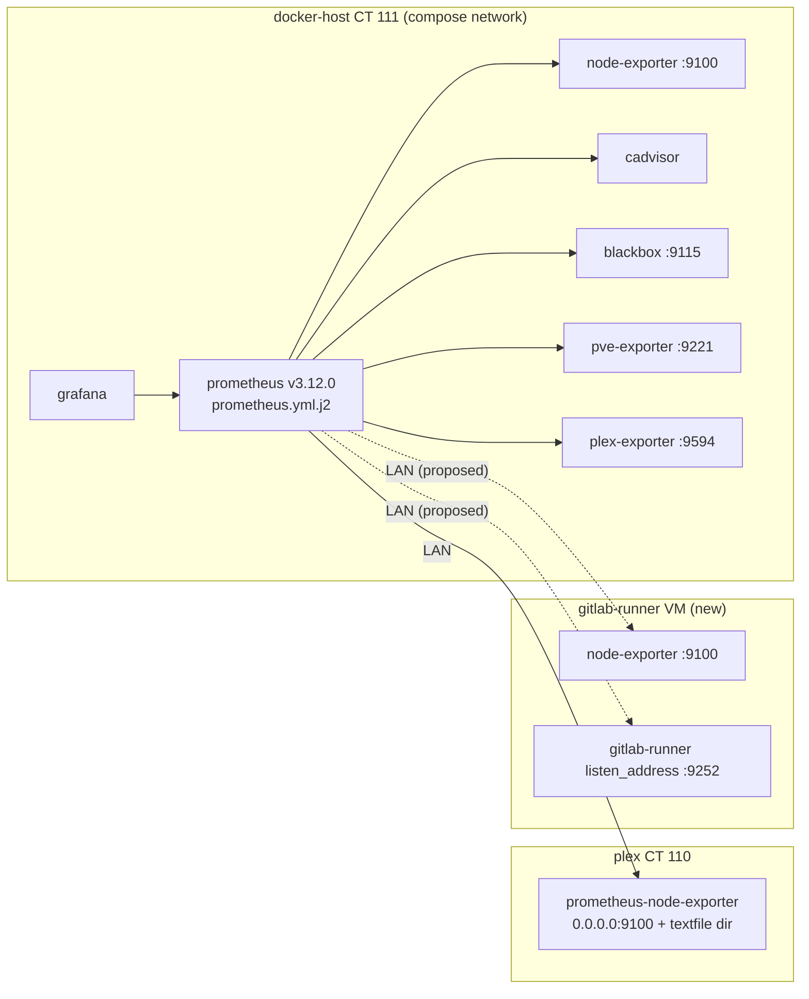

# Research: the existing monitoring stack and where a runner fits

Read on 2026-11-04 at `3f69dcb`.

## Current topology

## Findings

- **Scrape config** is `ansible/roles/docker_host/templates/prometheus.yml.j2`, rendered by the `docker_host` role and delivered through the `Restart prometheus` handler. Prometheus runs without `--web.enable-lifecycle`, so it only reloads on restart.
- **Cross-LAN precedent:** `plex-node-exporter` is the one job whose target is off the compose network. Its target is `"{{ hostvars['plex'].ansible_host }}:9100"`, quoted, and taken from the inventory rather than a second literal. The port is cross-checked by a guard against the `plex` role's `plex_node_exporter_listen_address`. A runner job would copy this shape: `hostvars['<runner host>'].ansible_host`. **Caveat:** `hostvars` for a host outside the current play has `ansible_host` only from inventory, which works, but **facts are not available**. Any multi-node list should be built from `groups['gitlab_runner']`. The guard's `_LINE_BOUNDED_EXPR` refuses `groups[...] | first` forms (see the comment at `prometheus.yml.j2` plex-node-exporter), so a list of runners needs a Jinja `for` loop. That needs a guard extension or an explicit allowance in `scripts/test_traefik_config_shape.py`, a 6000+ line guard file that pins every scrape job.
- **CT 110's node-exporter** is the Debian package `prometheus-node-exporter`, set up with a systemd override (`roles/plex`, `plex_node_exporter_*` defaults, listen `0.0.0.0:9100`, some collectors disabled). Ubuntu ships the same package name, so the runner role can follow the same pattern.
- **Disk alert:** `templates/host-disk-rules.yml.j2`, group `host-disk`:
  - `HostRootFilesystemLow` (<15% for 10m, warning) and `HostRootFilesystemCritical` (<5% for 5m) on `node_filesystem_avail_bytes{mountpoint="/"} / size`. They select no job, so **a new node-exporter job is covered by these two rules automatically**, and the annotations would need the runner job's name added.
  - `HostRootFilesystemSeriesAbsent` has one `absent()` per job (`node-exporter`, `plex-node-exporter`). A runner job needs a third `or absent(...{job="gitlab-runner-node"})` arm.
  - Guarded by `scripts/test_host_disk_alert_rules_promtool.py`, which runs `promtool test rules` with fixtures for each job (`DOCKER_HOST_FS`, `PLEX_FS`). A new job means a new fixture and a new absent case.
- **No Alertmanager:** rules evaluate and show in the Prometheus UI and Grafana, but nothing pushes (`plex-blip-rules.yml.j2` header). A runner disk alert is therefore "visible", not "paged". Worth stating in the runbook.
- **Exposure:** both exporters on the runner VM would listen on the LAN without auth, the same as CT 110's. Their data (host stats, job counts) is not secret, and CI jobs on the VM can read it anyway.
- **Runner metrics endpoint:** gitlab-runner's `listen_address` in config.toml (details in gitlab-runner-registration.md). Proposed job name: `gitlab-runner`.

## Fit assessment
It fits, at the cost of extending the two guard files above. It is a separate, later plan step that touches CT 111 (a `docker_host` render plus a Prometheus restart), so it needs its own operator gate. The runner works without it.
