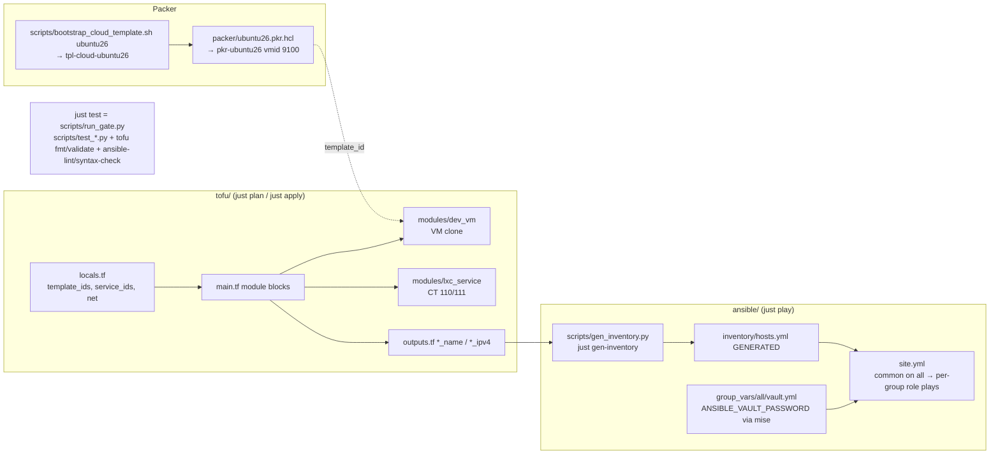

# Research: repo conventions the runner must fit

Read on 2026-11-04 at `3f69dcb` (branch `worktree/ll-gitlab-runner`). Every claim below cites the file it came from.

## Pipeline shape

## Findings

### Packer Ubuntu template (`packer/ubuntu26.pkr.hcl`, `packer/seed/ubuntu26/user-data`)
- `pkr-ubuntu26`, vmid 9100, Ubuntu **26.04**, cloned from `tpl-cloud-ubuntu26` (OVMF/q35 inherited from the bootstrap).
- The cidata seed bakes in user `user` with password **`password`**, `NOPASSWD:ALL` sudo, and `ssh_pwauth: true` (the "C-6 weak-creds posture" for dev VMs). It does **not** bake in an SSH key. root has no credential.
- Its last provisioner seals the template (cloud-init clean, machine-id truncate, ssh host keys removed), so each clone gets its own identity.
- **Implication:** a runner VM cloned as-is is reachable from the LAN as `user`/`password` with root via sudo. This VM runs untrusted CI code as root, and the brief says nothing else should be readable on it. The runner plan must add a key and turn off password auth before anything else lands.

### `tofu/modules/dev_vm` (the "existing tofu VM module")
- It is a bare clone: `cpu.cores`, `memory.dedicated`, a single `scsi0` disk (`local-lvm`, discard, ssd), one NIC on `vmbr0`, the guest agent enabled, and `initialization.ip_config` = **DHCP only**. It has no `user_account`, no SSH keys, and no static IP. Per its README this is "intentionally bare" (Q6/A6, C-6).
- `node` is already a variable (default `pve`), which covers the brief's "node is a variable" requirement at module level.
- `versions.tf` pins `bpg/proxmox ~> 0.104.0`, but the root and `lxc_service` require `>= 0.108.0`. **These constraints can't both be met**: `~> 0.104.0` means `>= 0.104.0, < 0.105.0`. The root does not call `dev_vm` today, so this has never surfaced. The first `module "gitlab_runner" { source = "./modules/dev_vm" }` in the root will make `tofu init` fail. The pin has to move to `>= 0.108.0`, which matches the design table's own note ("≥0.108 (~>0.104)").
- Its outputs are `vm_id`, `name`, and `ipv4_address` = `try(ipv4_addresses[1][0], null)`. That value is best-effort: the guest agent has to be up, and index 1 assumes `lo` is index 0.
- `scripts/test_dev_vm_module_shape.py` guards the module. It checks the required files, `tofu validate`, the `os` validation, the presence of an `initialization` block, and that the module takes no consumer cidata variables (`test_no_consumer_cidata_variables`). Adding `user_account`/keys/static-IP variables has to get past that guard, or the guard needs a deliberate, licensed rewrite (see memory: polarity flips).
- `tofu/locals.tf` holds `template_ids.ubuntu26 = 9100`, `service_ids` (110, 111), and `net` (gateway .1, `vmbr0`, per-service static CIDRs, `dns_servers`, `dns_domain = home.arpa`). There is a static address convention: .110 plex, .111 docker-host.

### Ansible
- `ansible.cfg`: `inventory/hosts.yml`, `roles_path = roles:galaxy_roles`, vendored collections, `vault_password_file = vault-pass.sh` (reads `$ANSIBLE_VAULT_PASSWORD`), pipelining.
- `inventory/hosts.yml` is **generated** by `scripts/gen_inventory.py` from `tofu output -json`. Each group is a hard-coded block with a static fallback IP, and `ansible_user: root` is the same for every host. A VM group needs its own block and an `ansible_user` that isn't root (`user` + become), or root keys.
- `site.yml`: play 1 runs `common` on `all` (it has a Plex-apt pre_task that only acts when that source exists). Then one play per group runs one role.
- `roles/common`: base packages, unattended-upgrades, timezone, the `svc` user, and sshd hardening (`PermitRootLogin prohibit-password`, **`PasswordAuthentication no`**). The meta lists Debian platforms only, but the tasks are generic apt and run fine on Ubuntu. **Ordering hazard:** `common` turns off password SSH. If the runner VM is reached by password the first time, the operator's key has to be installed before or during that same run, or the second run is locked out.
- `roles/docker_host` gets Docker CE through the **`geerlingguy.docker` 8.0.0** meta dependency (vendored and pinned in `requirements.yml`). That role installs from Docker's official apt repo (`docker_apt_release_channel: stable`). `scripts/test_ansible_layout_shape.py::test_docker_install_delegated_to_geerlingguy_role` makes it the repo's convention. Reusing it for the runner meets "Docker from the official apt repo" with no new code. Still to check: whether geerlingguy.docker 8.0.0 supports Ubuntu 26.04's codename.
- Secrets: one vault file at `group_vars/all/vault.yml` holds `vault_*` names (for example `vault_pve_api_token`), and `test_secrets_scoped_to_all_group` scopes them to the `all` group. **Every host's play can therefore read the vault file**, including CT 111's tokens. That's acceptable because the vault is decrypted on the controller and only vars a role actually renders reach a host. The runner role must render only its own `glrt-` tokens.
- Conventions: exact version pins, idempotent tasks (no unguarded `command`/`shell`, `changed_when` on handlers), `ansible-lint --offline --profile production`, and long "why" comments that cite measurements.

### Gate and recipes
- `just test` runs `scripts/run_gate.py`: every `scripts/test_*.py` standalone (picked up by glob), then `tofu fmt -check`, `tofu init -backend=false`, `tofu validate`, then `ansible-lint --offline` and `ansible-playbook --syntax-check`. New shape tests drop in under `scripts/` with no other wiring.
- Recipes: `plan`, `apply` (interactive, `preflight_tofu_auth.py`), `fmt`, `play` (whole `site.yml`), `gen-inventory`, `provision`. There is no per-host play recipe yet. `just play` touches CT 110/111 as well. A `play-runner` recipe (`ansible-playbook site.yml --limit gitlab_runner`) would keep runner iterations off the live Plex and Traefik hosts.
- Runbooks live in `docs/runbooks/*.md`, and most have a `scripts/test_*_runbook_shape.py` guard that pins required sections.

### Planning history
- Every project uses `.agents/planning/<date>-<slug>/{rough-idea,idea-honing,research/,design/detailed-design.md,implementation/plan.md,summary.md}`, and ralph loops add `implementation/{context,progress}.md`.
- Recurring lessons in memory that apply here: measure rather than reason (the docker "Up" status lies), guard tables by cell identity, flip a guard's polarity instead of deleting it, and backticks in shell echo are command substitution (keep `ralph emit` payloads in heredocs).

## Key constraints for the design
1. Fix the `dev_vm` provider pin (`~> 0.104.0` → `>= 0.108.0`) before using it.
2. `dev_vm` needs: SSH keys for the operator, either via `initialization.user_account` or Ansible's first contact with `user`/`password`; a static IP or a DHCP reservation; and a stable vmid. Each option either touches `test_no_consumer_cidata_variables` or adds a bootstrap step.
3. The template's weak credentials have to be gone before the VM is considered done.
4. Inventory generation needs a `gitlab_runner` group fed by new tofu outputs.
5. Reuse geerlingguy.docker for Docker CE (check Ubuntu 26.04 support).

## Addendum: geerlingguy.docker 8.0.0 details (`ansible/galaxy_roles/geerlingguy.docker`)
- It writes a deb822 source with `suites: {{ ansible_facts.distribution_release }}`, so on Ubuntu 26.04 the suite is that release's codename. That only works if download.docker.com already publishes the suite (see docker-upkeep.md). There is no override variable for the suite.
- `docker_packages_state: present` is the default, so **a normal playbook run never upgrades Docker**. The brief requires "upgrade through the normal playbook run", so the runner play sets `docker_packages_state: latest`. That leaves the playbook change-free on a second run only when no new upstream package came out in between, which is the honest meaning of "second run changes nothing".
- `docker_daemon_options: {}` is rendered to `/etc/docker/daemon.json`, which is where log rotation goes (`log-driver: json-file`, `log-opts.max-size`/`max-file`). That is the "bounded container logs" pattern from docker-host commit 3f69dcb.
- `docker_users: []` should stay empty. No login user needs to be in the docker group.
