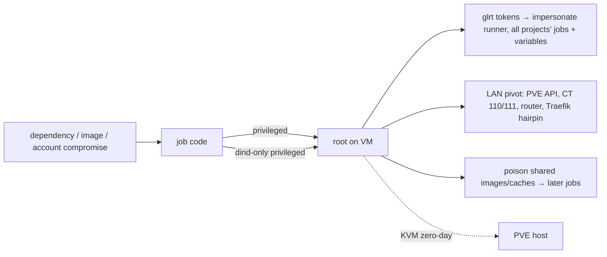

# Security evaluation: synthesis and ranked options

This synthesises `security-threat-model.md`, `security-privileged-alternatives.md` and `security-containment.md` (2026-11-04). Those three files hold the sources.

## The model in one paragraph

Anyone who can get code into a job can become root on the runner VM. Today that means a compromised dependency or upstream image, or your own gitlab.com account, because lumologic is private with one member. Two things follow from root on the VM, and they matter far more than a VM escape, which would need a KVM zero-day:

1. **Token theft.** Every `glrt-` token in config.toml can be stolen. With it an attacker can impersonate the runner from anywhere, receive every attached project's jobs together with their CI variables, and lock the operator out by self-rotating the token.
2. **LAN pivot.** The flat LAN reaches the PVE API, CT 110 and 111, and the router. In-VM nftables can be flushed and ARP can be spoofed.

Second-order risks are cross-job poisoning through the shared image cache and cache volumes, and other concurrent jobs' variables showing up via `docker inspect`.

## Ranked options

| Rank | Control | Closes | Cost here | Residual |
|---|---|---|---|---|
| 1 | **Privileged only for `docker:*-dind`**, plus `disable_entrypoint_overwrite`, `FF_NETWORK_PER_BUILD` and `FF_ENABLE_JOB_CLEANUP` | Opportunistic malware in non-dind jobs (npm, pip, Playwright) no longer gets root | config.toml only | A deliberate attacker still reaches root through dind |
| 2 | **Fix nftables gaps:** IPv6 (block LAN v6 prefixes and link-local), plus measuring and closing the WAN-IP hairpin to Traefik's internal allowlist | Bypasses of the planned egress block | small. The hairpin fix may touch Traefik's allowlist (CT 111) | Root can still flush nftables |
| 3 | **GitLab-side hygiene:** lock each runner to its project, turn off fork pipelines in the parent, set the max timeout just above 5400 s, keep the job-token allowlist at its default; runbook rule "Developer+ = root on the runner" | Accidental widening; the fork-MR path | operator clicks plus runbook | none added |
| 4 | **Proxmox VM firewall from tofu** (datacenter enable with `input_policy = ACCEPT`, node firewall off, VM policy DROP, ipfilter/macfilter, `radv = false`) | LAN pivot and spoofing, and it can't be undone from inside the VM | about 1 plan step. **Lockout risk** to `pve` if the defaults are taken; it needs a careful sequence | Internet egress remains open, by design |
| 5 | **Split runner manager:** unprivileged LXC holds config.toml and tokens, and drives the job VM's dockerd over TLS | Token theft. A compromise ends at a re-image of the job VM | about 1 plan step. Certs in the vault, a dockerd TCP listener, a drain across two hosts | Concurrent jobs' variables and cache poisoning remain on the job VM |
| 6 | **sysbox-runc trial** on a throwaway VM, preferably Ubuntu 24.04 | Root on the VM via dind (needs a kernel or sysbox bug) | a trial plus possibly a different OS; best-effort upstream | Maintenance risk; 26.04 unsupported |
| 7 | **Routine re-image** (monthly and on upgrades) plus a compromise playbook (pause → re-image → delete and recreate the runner, using the ID-based reset) | Persistence from cache poisoning or implants | runbook only (about 15–20 min hands-on) | none |
| — | Rejected: protected runners (untagged MR and feature jobs would hang), VLAN (depends on the router, takes days), rootless dind, Kata, gVisor, userns-remap, seccomp/AppArmor (each breaks the unmodified job or adds nothing) | | | |

## Also noted
- Pin `cpu.type` explicitly in `dev_vm`: the template has `host`, but bpg's schema default is `qemu64`.
- A 150 GB thin volume can fill the `local-lvm` pool that Plex and Traefik share. The disk alert covers the guest's view only; check pool headroom before apply.
- `allowed_images` and `allowed_services` allow-lists would narrow what jobs can run, but they conflict with the "general homelab runner" goal. Optional.
