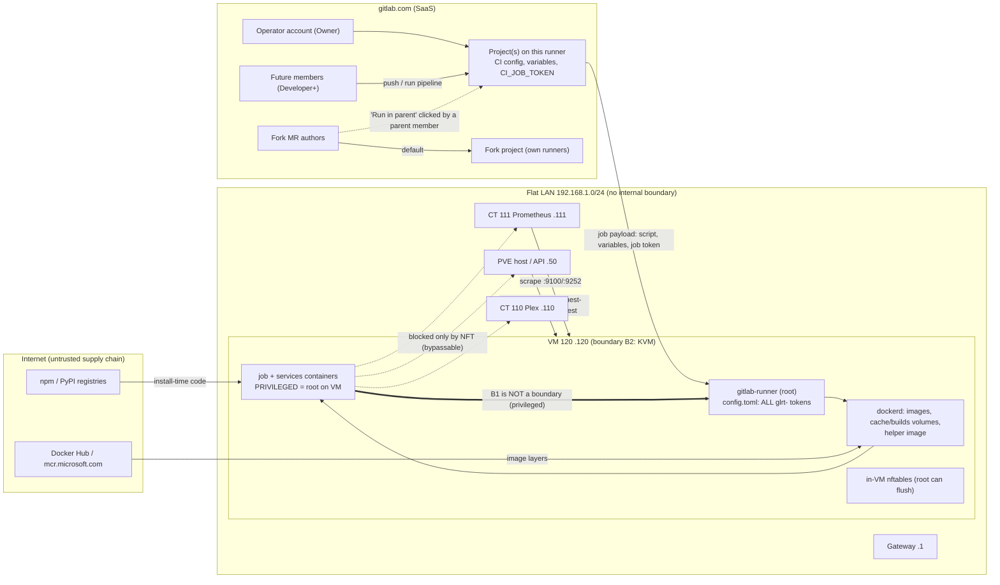

# Research: Security threat model for the self-hosted GitLab Runner VM

Researched 2026-11-04 against docs.gitlab.com (GitLab.com SaaS, current docs) and gitlab.com issues. Each claim is tagged:

- **[doc]**: stated by the cited official page.
- **[issue]**: reported in a gitlab.com issue or MR, not necessarily current behaviour.
- **[inferred]**: my reasoning from documented behaviour or from this repo's code, not stated by a source. Verify these before relying on them.

The subject is the design in `../design/detailed-design.md`:

- VM 120 at 192.168.1.120 on `pve`, on a flat 192.168.1.0/24 LAN with the PVE API at .50, Plex CT .110 and docker-host/Prometheus CT .111.
- Docker executor with `privileged = true`, `pull_policy = ["if-not-present"]` and untagged jobs.
- `glrt-` project runners, with every runner's token in one `/etc/gitlab-runner/config.toml`.
- No change to any project's `.gitlab-ci.yml` is allowed.

Background on privileged mode is in `dind-tls-docker-executor.md` §4. That section establishes that any job, and any service, is root on the VM.

---

## 1. Threat model: who can make code run on this runner

### 1.1 Actors and entry paths

| # | Actor / path | Can it run code here? | Source |
|---|---|---|---|
| A1 | **Project member, Developer or above.** Pushes a branch, retries a job, or runs a pipeline | Yes. "Run, rerun, or retry CI/CD pipeline or job" is Developer, Maintainer and Owner. The runner is unprotected and runs untagged jobs, so every branch pipeline lands here | [doc] <https://docs.gitlab.com/user/permissions/>. The runner security page says "Any user that has the Developer role for the project's repository could compromise the security" of the runner host [doc] <https://docs.gitlab.com/runner/security/> |
| A2 | **Reporter, Guest or Planner** | Not directly: Reporters "cannot push code" and can't run pipelines. Reporters can read job logs | [doc] <https://docs.gitlab.com/user/permissions/> |
| A3 | **Same-project MR pipelines** | Yes, for the same Developer+ population as A1. "You must have the Developer, Maintainer, or Owner role for the source project to run a merge request pipeline." | [doc] <https://docs.gitlab.com/ci/pipelines/merge_request_pipelines/> |
| A4 | **Fork MR, default behaviour** | No. The pipeline "Is created and runs in the fork (source) project, not the parent (target) project" and "Uses the fork project's CI/CD configuration, resources, and project CI/CD variables". Parent project runners are not used. **[inferred]**: "resources" covers runners, since project runners belong to the parent and aren't enabled in the fork | [doc] <https://docs.gitlab.com/ci/pipelines/merge_request_pipelines/> |
| A5 | **Fork MR, "Run pipeline in parent project"** | Yes, and this path is dangerous. The pipeline runs in the parent with "the CI/CD configuration present in the fork project's branch" and "the parent project's CI/CD settings, resources, and project CI/CD variables", using the permissions of the parent member who triggers it. A parent member who can run pipelines must click it and accept a warning. API- and `/rebase`-triggered runs skip the warning. Per the CI variables doc, "all variables become available to the pipeline" | [doc] <https://docs.gitlab.com/ci/pipelines/merge_request_pipelines/>, <https://docs.gitlab.com/ci/variables/> |
| A6 | **Who can fork a private project at all** | Only members. "For **private** projects, this excludes the Guest role as those users cannot clone private projects." **[inferred]**: on a private project whose only member is the operator, A4 and A5 need a second member first | [doc] <https://docs.gitlab.com/user/permissions/> |
| A7 | **Scheduled pipelines** | Yes. They run "with the permissions of the user who owns the schedule". Developer+ can create a schedule, but only "for branches where the user has merge permissions". A Maintainer or Owner can take ownership, and the pipeline then runs as them | [doc] <https://docs.gitlab.com/ci/pipelines/schedules/> |
| A8 | **Compromised dependency** in a job's `npm install` / `pip install` (postinstall hooks, typosquats, a hijacked maintainer) | Yes. **[inferred]**: the install runs inside the job container, which is privileged, so a malicious package is root on the VM with no further exploit. In the current threat landscape this is the most plausible way hostile code arrives for a single-operator setup. GitLab says "You should lock down package dependencies in your jobs" | [doc] <https://docs.gitlab.com/ci/pipeline_security/> |
| A9 | **Compromised upstream image or tag** (`node:24`, `python:3.14-slim`, `docker:29-dind`, `mcr.microsoft.com/playwright`) | Yes, same as A8. GitLab: "Always use SHA digests for Docker images". We can't change `.gitlab-ci.yml`, so digest pinning is out of our hands. **[inferred]**: `allowed_images` on the runner side is the only lever | [doc] <https://docs.gitlab.com/ci/pipeline_security/>, <https://docs.gitlab.com/ci/docker/using_docker_images/> |
| A10 | **Operator's gitlab.com account or a PAT compromised** | Yes. Anyone acting as the operator can push or edit CI in every project on the runner. **[inferred]** | — |
| A11 | **Leaked `glrt-` token** (vault leak, a backup, a pasted log) | A fake runner can *receive* jobs, with their variables and source. It can't cause code to run on *this* VM. "If a runner's authentication token is exposed, an attacker could use it to clone the runner." | [doc] <https://docs.gitlab.com/ci/runners/configure_runners/> |
| A12 | **Another project enabled on this runner later** | Yes. A Maintainer of both the runner's project and the target project can enable an unlocked project runner there | [doc] <https://docs.gitlab.com/ci/runners/runners_scope/> |

**Conclusion for today [inferred]:** `lumologic/lumologic` is private and the operator is its only member. That leaves only A8, A9 and A10. A1, A3, A5, A7 and A12 come into play only once a second person gets Developer+ on any project that uses this runner, or once a project is made public.

### 1.2 Trust boundaries

Boundaries:

- **B1, job container to VM:** absent under `privileged = true`.
- **B2, VM to PVE host:** KVM/QEMU. This is the only strong boundary in the design.
- **B3, VM to LAN:** only the in-VM nftables table, which root can remove (design R19). On the LAN side there is no boundary at all.
- **B4, runner to gitlab.com:** a bearer token. Holding the token makes you the runner.

---

## 2. What a malicious job (root on the VM) can obtain or do

| Capability | How | Tag |
|---|---|---|
| **Every runner's `glrt-` token** | Read `/etc/gitlab-runner/config.toml` from the host filesystem: mount the VM disk, or `nsenter -t 1`. Mode 0600 is irrelevant to root | [inferred], from the privileged facts in dind §4 |
| **Impersonate the runner, so it gets other projects' jobs** | Poll `/api/v4/jobs/request` with a stolen token from anywhere. It receives jobs for **every project that runner is enabled in**, racing the real runner. "If you clone a runner then the cloned runner could be picking up the same jobs for that token." ([doc] <https://docs.gitlab.com/runner/security/>). "Anyone with the authentication token can clone a runner and submit false jobs" ([doc] <https://docs.gitlab.com/ci/runners/configure_runners/>). A `glrt-` token also needs a `system_id`, but the attacker chooses that value. [inferred], from <https://docs.gitlab.com/api/runners/> (`system_id` "required" for `glrt-`) | [doc]/[inferred] |
| **Those jobs' CI/CD variables** | **[inferred]**: the job payload has to carry every variable the job is entitled to, because that is how a runner delivers them. The variable flags only limit *where* a value goes:  - **masked** "is replaced with `[MASKED]` in the job log", and "Masking a CI/CD variable is not a guaranteed way to prevent malicious users from accessing variable values";  - **hidden** only "cannot be revealed in the UI again";  - **protected** is "only available in pipelines that run on protected branches or protected tags".  An *unprotected* runner also runs protected-ref jobs, such as `main`, so it receives protected variables too | [doc] <https://docs.gitlab.com/ci/variables/> |
| **`CI_JOB_TOKEN` of every job it sees** | This includes jobs running concurrently on this VM: root can read `docker inspect` env on other containers [inferred]. The token "receives the same access level as the user that triggered the pipeline" (the operator, i.e. Owner), is limited to specific endpoints, can't use GraphQL, and is "valid only while the job is running". By default, "the allowlist of any project only includes itself" | [doc] <https://docs.gitlab.com/ci/jobs/ci_job_token/> |
| **Source code of other projects** | It comes from impersonated jobs, from other projects' `builds` volumes on the VM, and from the Git credentials in the job payload [inferred] | [inferred] |
| **Read cached private images from other projects** | With `if-not-present`, a cached image is used without a registry auth check. The pull policy "should be used **only** for specific runners used by trusted builds and users" ([doc] <https://docs.gitlab.com/runner/security/>, <https://docs.gitlab.com/runner/executors/docker/>; [issue] <https://gitlab.com/gitlab-org/gitlab/-/issues/21619>, <https://gitlab.com/gitlab-org/gitlab-runner/-/issues/3279>). There is also a reported bypass: `allowed_pull_policies = ["always"]` still uses the cache when a job lists `[if-not-present, always]` ([issue] <https://gitlab.com/gitlab-org/gitlab-runner/-/work_items/38706>, status not shown on the page) | [doc]/[issue] |
| **Poison images for later jobs, across projects** | Root runs `docker tag evil:latest node:24` on the host daemon. Under `if-not-present` the next job in *any* project that names `node:24` runs the attacker's image. The GitLab docs warn about the *read* direction only. The *write* (poisoning) direction is my inference; I found no doc or issue describing it | [inferred] |
| **Poison the helper image** | The helper image does git clone, LFS, cache and artifacts, and it sees the job token and source. Root can replace the local `gitlab-runner-helper` tag or the image tarball, and every later job of every project uses the replacement | [inferred] |
| **Poison other projects' caches and build dirs** | Runner volumes are named per project (`runner-<short-token>-project-<id>-concurrent-<n>-cache-<md5>` before 18.4; the scheme changed in 18.4 [doc] <https://docs.gitlab.com/runner/executors/docker/>). Naming is not access control, so root can mount any of them and plant `node_modules`, `.git/hooks` or `.git/config`. GitLab warns that reused repository copies under `GIT_STRATEGY: fetch` let users "inject code into other pipelines" and recommends `FF_ENABLE_JOB_CLEANUP` on static hosts ([doc] <https://docs.gitlab.com/runner/security/>) | [doc]/[inferred] |
| **Persistence across jobs and reboots** | Replace `dockerd`, `gitlab-runner`, or systemd units; add a cron or timer; edit `config.toml`. The runner hot-reloads it within 3 s (design §B). Changes like these survive until a re-image. **[inferred]**: an Ansible re-run doesn't detect binary tampering, and the template only restores the files it manages | [inferred] |
| **Disable the egress fence** | `nft delete table inet ci_egress`. Already documented as a limitation in design R19 | [inferred] |
| **LAN pivot** | Reach 192.168.1.50 (PVE web UI and API on 8006, SSH), .110 (Plex), .111 (Prometheus and Grafana; the Prometheus HTTP API is typically unauthenticated), the gateway admin UI, and anything else on the /24. **[inferred]**: on a flat L2, root can also ARP-spoof any LAN IP. This repo has seen that happen by accident: memory note "Contain a fake target IP in the container's netns", where a fake IP on lo ARP-stole CT 110. `tofu/modules/dev_vm/main.tf` sets no NIC `firewall`, so PVE's `ipfilter`/`macfilter` anti-spoofing doesn't apply. The VM is meant to hold no credentials for those hosts (R18), so a pivot needs a separate vulnerability or weak credentials on the target | [inferred]; PVE `ipfilter` "mainly used to prevent IP spoofing" [doc] <https://pve.proxmox.com/wiki/Firewall> |
| **Abuse the egress itself** | Mining, a spam or DDoS source, or C2 from the home IP. **[inferred]**: the nftables design allows all non-LAN egress, and it has to, for registries and gitlab.com | [inferred] |
| **Escape VM to PVE** | **Realistic? No, for this threat level [inferred].** It would need a QEMU/KVM or virtio device escape. Those exist (they are rare, high-value bugs) but are not what commodity CI malware carries. **qemu-guest-agent direction:** `agent { enabled = true }` in `dev_vm`. The agent lets the *host* run commands in the guest (`guest-exec`); it is not a channel for guest-to-host commands. Upstream maintainers treat the host as trusted and the agent as no boundary against it (libvirt-list, 2017: <https://listman.redhat.com/archives/libvir-list/2017-August/152526.html>). A root guest can lie in agent replies, for example the IP that tofu reads as `ipv4_address`. That is why the design's deterministic `ipv4_configured` output is the safer one to consume | [inferred] |
| **Pivot via the Prometheus scrape** | CT 111 connects *to* the VM on :9100 and :9252. Root controls those responses and can serve garbage or very high-cardinality metrics. That gives DoS of Prometheus, not code execution [inferred] | [inferred] |

---

## 3. GitLab-side controls: what each one actually mitigates

| Control | What it does (documented) | What it mitigates here | What it does **not** do |
|---|---|---|---|
| **Protected runner** (`access_level = ref_protected`) | Runs "only … jobs on protected branches" and protected tags ([doc] <https://docs.gitlab.com/ci/runners/configure_runners/>, <https://docs.gitlab.com/api/runners/>). **MR pipelines:** since GitLab 18.1 they reach protected runners and variables only when "Both the source and target branches are protected", the triggerer "has push/merge access to the target branch", and both branches are in the same project, behind the checkbox "Allow merge request pipelines to access protected variables and runners". "Merge request pipelines from forked repositories cannot access these protected resources." ([doc] <https://docs.gitlab.com/ci/pipelines/merge_request_pipelines/>) | Keeps code from feature branches, MRs, forks and Developers without merge rights off the VM. Combined with protected branches, only people with merge/push rights to protected refs can run code here | **Interaction with untagged jobs and our constraint [inferred]:** `run_untagged` and `access_level` are independent filters (<https://docs.gitlab.com/api/runners/>). With instance runners off, every feature-branch and MR job in lumologic stays **pending forever**, and we can't add tags or rules to fix that. Also, a protected runner's token is *more* valuable to steal, because it only ever receives protected-ref jobs carrying protected variables. And it does nothing about A8/A9 on `main` |
| **Locked runner** ("cannot be enabled for other projects") | A project runner "locked" can't be enabled elsewhere. Enabling an unlocked one needs Maintainer/Owner on both projects. Instance and group runners can't be locked ([doc] <https://docs.gitlab.com/ci/runners/runners_scope/>, `locked` in <https://docs.gitlab.com/api/runners/>) | Stops a Maintainer of lumologic who also maintains some other project from attaching that project, and its members' code, to this privileged VM (A12) | Doesn't limit anything within the projects it already serves, and doesn't protect tokens on the VM |
| **One runner per project vs one shared** | Each project runner has its own `glrt-` token and owner project ([doc] runners_scope) | **Attribution and blast-radius control *outside* the VM:** a token that leaks off-box (A11) exposes only that project's jobs, and you can pause, reset or delete one project's runner without touching others | **No isolation *on* the VM [inferred]:** all tokens sit in one `config.toml` and one job reads them all. Real separation needs a VM per trust domain. The design's Appendix D already says so |
| **Protected variables** | Only in pipelines on protected refs ([doc] variables) | Keeps deploy secrets from feature-branch jobs, which matters once there are Developers without merge rights | A job *on* a protected ref, or any job that steals an unprotected runner's token, still receives them. A8/A9 on `main` get them |
| **Masked variables** | `[MASKED]` in job logs; "not a guaranteed way to prevent malicious users from accessing variable values" ([doc] variables) | Accidental leaks to log readers (Reporter+) | Nothing against a malicious job |
| **Hidden variables** | Can't be revealed in the UI after saving; jobs still receive them ([doc] variables) | Stops humans with settings access (Maintainer+) from reading the value | Nothing against a malicious job or a stolen runner token |
| **`CI_JOB_TOKEN` allowlist** | By default "the allowlist of any project only includes itself"; fine-grained permissions can narrow the reachable endpoints; the token is valid only while the job runs ([doc] <https://docs.gitlab.com/ci/jobs/ci_job_token/>) | Limits what a stolen job token can reach: other projects only if they allowlisted this one. Keep every project's allowlist minimal and avoid enabling job-token Git push | The token still acts with the triggerer's access (Owner here) on its own project for the life of the job, and a 90-minute job is a long window |
| **"Pipelines must succeed" / merge checks** | Gates *merging*, not *execution* | Nothing here [inferred]. The code runs before the check matters | — |
| **Who can run pipelines** | Developer+ ([doc] permissions); fork MR in parent needs a parent member with run-pipeline rights plus a warning ([doc] MR pipelines) | Membership is the real control. Keep Developer+ on runner-attached projects to people you'd hand root on the VM | No GitLab.com setting raises the bar to "Maintainer only" for branch pipelines [inferred; none found] |
| **Disable fork pipelines in parent** | Projects API: disable `ci_allow_fork_pipelines_to_run_in_parent_project`; "Pipelines created before the setting was disabled are not affected" ([doc] MR pipelines; [issue/MR] <https://gitlab.com/gitlab-org/gitlab/-/merge_requests/94302> says it's enabled by default) | Closes A5 entirely. It costs nothing on a single-member project | Nothing else. A settings change is outside R23's "no project settings" scope, so it's an operator action |
| **Runner token reset** | `POST /runners/:id/reset_authentication_token` (Maintainer/Owner, `manage_runner` scope) or `POST /runners/reset_authentication_token` with the current token; the docs' reset procedure is "delete the runner, create a new one" ([doc] <https://docs.gitlab.com/api/runners/>, <https://docs.gitlab.com/ci/runners/configure_runners/>) | Evicts an impersonating clone after compromise | **[inferred]:** with a token stolen from the VM, the attacker can call the self-reset endpoint first and lock *you* out of that token, so prefer delete-and-recreate under your own account. Resetting before re-imaging is pointless, because the implant just reads the new token. Order: **pause → re-image → reset/recreate → vault → play** |
| **Pause runner** (`paused`) | "Specifies if the runner should ignore new jobs" ([doc] runners API); Maintainer or admin ([doc] runners_scope) | First-response kill switch from gitlab.com, without touching the VM | **[inferred]:** applies per runner; a clone using the same token is paused too. Running jobs carry on |
| **Maximum job timeout** | Minimum 600 s ([doc] configure_runners) | Caps the life of a job token and a hostile job's dwell time. Set it to just above 5400 s | — |
| **Runner-side `allowed_images` / `allowed_services`** (config.toml, not project CI) | Wildcard lists of images/services a `.gitlab-ci.yml` may name ([doc] <https://docs.gitlab.com/runner/configuration/advanced-configuration/>) | Shrinks A9 to the named upstream repos | Doesn't pin digests, and doesn't stop a compromised allowed tag |

### 3.1 GitLab's runner security guidance (<https://docs.gitlab.com/runner/security/>) applied to docker + privileged

The page's sections are: executor risks (Shell, **Docker**, **if-not-present with private images**, Docker credential helpers, SSH, Parallels); Cloning a runner; `GIT_STRATEGY: fetch` on shared environments; and hardening (**privileged containers**, **network segmentation**, **secure the runner host**, **clean up .git**). The relevant recommendations, with how this design stands against each:

1. **Developer = host risk.** "Any user that has the Developer role … could compromise the security" of the host, and "Secret variables exposed to jobs running in a compromised environment can be stolen". → **Compliant for now**: single operator, private project. Make it a written rule in the runbook.
2. **Docker executor is safe only unprivileged.** "When privileged mode is enabled, a user running a CI/CD job could gain full root access to the runner's host system"; "It is not advised to run containers in privileged mode". → **Deviates (R2, required)**. See 3.2 for a cheaper partial fix.
3. **Privileged only on "isolated and ephemeral virtual machines"**, on "dedicated runners" configured "to execute jobs only on protected branches." → Isolated: **partly** (dedicated VM, but on a flat LAN). Ephemeral: **no** (static VM). Protected branches: **no**, because untagged feature-branch jobs must run.
4. **`if-not-present` "only for specific runners used by trusted builds and users".** → **Compliant** while it's single-operator. Re-evaluate once any project gets a second member. Also note the *write* direction (poisoning) in §2.
5. **Docker credential helpers** are disabled by default (`allowed_docker_credential_helpers`), and you should not `docker login` as the runner user on shared runners. → **Compliant**: the design has no host `docker login`. Keep it that way, because host registry creds would be readable by every job.
6. **Cloning a runner** means the token clone picks up the same jobs. → Covered by the reset procedure.
7. **`GIT_STRATEGY: fetch` on shared environments** lets reused repo copies inject code into other pipelines. Use it "only when you trust everyone with access"; enable `FF_ENABLE_JOB_CLEANUP` on static hosts. → **Add `FF_ENABLE_JOB_CLEANUP`** (cheap) as a runner `environment`/feature flag. It doesn't help against root, but it closes the accidental and unprivileged cross-run reuse.
8. **Network segmentation**: "running them in their own network segment"; restrict traffic between runner VMs; filter metadata endpoints. → **Partly**: in-VM nftables only. The page's intent is an enforcement point the job can't touch, which here means the PVE firewall or a VLAN.
9. **Secure the runner host**: OS hardening, and remove SSH keys or other files that grant access elsewhere. → **Compliant** (R18, R20).

### 3.2 Runner-side knobs that don't touch `.gitlab-ci.yml` [inferred unless cited]

- **Narrow privilege to the dind service.** Set `privileged = false`, `services_privileged = true`, and `allowed_privileged_services = ["docker:*-dind", "docker:dind", "docker.io/library/docker:*-dind"]`.
  - Documented semantics: "A build container runs in privileged mode when `privileged` is `true` and the image matches `allowed_privileged_images`". Services run privileged when they match `allowed_privileged_services` and `services_privileged` is true. An *absent* list means "all images are allowed" (<https://docs.gitlab.com/runner/configuration/advanced-configuration/>). GitLab's own example lists only `docker:*-dind-rootless` images ([doc] <https://docs.gitlab.com/runner/executors/docker/>).
  - Effect: the job container, where `npm install` runs (A8), is no longer root on the VM. A DinD client needs no privilege; it only talks TLS to `docker:2376`.
  - **Limits:** a hostile job can still use the dind daemon it has certs for to `docker run --privileged -v /dev:/dev …`. dind is privileged, so the nested container sees the VM's devices, and that is root on the VM in two steps. A job can also declare a `docker:dind` service with its own `entrypoint`/`command`.
  - So this defeats **opportunistic** malware (env and credential stealers, miners) in jobs that don't use dind, and in non-dind stages of jobs that do. It doesn't stop a **targeted** attacker.
  - Before adopting it, check that no lumologic job runs privileged operations in its *job* container (for example `mount`, or `sysctl` in a non-dind job). Verify on the smoke test.
- **`allowed_images` / `allowed_services`** set to the families actually used (R1 list plus `docker:*`): shrinks A9.
- **`allowed_pull_policies = ["if-not-present"]`** (design default plus `always`): fine. Note [issue] 38706 above.
- **`FF_ENABLE_JOB_CLEANUP`**, per §3.1 item 7.
- **Off-VM enforcement (Proxmox firewall on the VM NIC).** Set `firewall = true` on the `network_device`, `policy_out` DROP or REJECT except the gateway (DNS and the default route), and `ipfilter` + `macfilter` (<https://pve.proxmox.com/wiki/Firewall>). This is enforced on the PVE host bridge, where root in the VM can't reach it [inferred; the page doesn't state where enforcement happens]. It is the one mitigation that survives a root job, and the design already names it as the later hardening.

---

## 4. Ranked risks (single operator, private projects, as designed)

Likelihood is for this homelab as it is today: one member, private projects, no forks. "Given RCE" means the row assumes row 1 has already happened.

| # | Risk | Likelihood | Impact | Cheapest effective mitigation |
|---|---|---|---|---|
| 1 | **Supply-chain code (npm/pip dependency or upstream image) runs as root on the VM** (A8/A9) | **Low–medium**: the only realistic path today; base rates for npm compromise are non-trivial | High: everything in §2 | `privileged=false` + `services_privileged=true` + `allowed_privileged_services` (§3.2) to defeat opportunistic payloads; `allowed_images`/`allowed_services`. The real fix (digests, lockfiles) is in project CI and out of scope |
| 2 | **LAN pivot or ARP spoofing from the VM** to PVE .50, Plex, Prometheus, the gateway | Low (given RCE: high, since nftables is flushable) | High: PVE UI or API, home network | **PVE firewall on the VM NIC** (`policy_out` DROP except gateway and internet, `ipfilter`, `macfilter`). Small tofu change, survives root. Keep the in-VM nftables as defence in depth |
| 3 | **Runner token theft, then impersonation** to harvest other projects' jobs, variables and source | Low (given RCE: certain) | Medium: limited to the operator's own projects, but includes any deploy secrets stored as variables | Keep deploy-grade secrets out of variables reachable by this runner, or behind a separate runner; runbook order **pause → re-image → delete/recreate runner → vault → play** |
| 4 | **Persistence and cross-job poisoning** (tagged images under `if-not-present`, helper image, cache and build volumes, host binaries) | Low (given RCE: likely if targeted) | Medium–high: silent and survives Ansible runs | Treat any suspicion as **re-image** (the VM is cattle via tofu); `FF_ENABLE_JOB_CLEANUP`; optionally a periodic scheduled re-image. Ephemeral VMs (fleeting) are the real fix and are out of scope |
| 5 | **Operator gitlab.com account or PAT compromise** (A10) | Low | High: arbitrary code on the runner, plus everything GitLab-side | 2FA or passkey; scope and expire PATs; the `manage_runner`-scoped token is not stored on the VM |
| 6 | **Future member with Developer+**, or another project attached later (A1/A3/A7/A12) | Very low today | High: they get root on the VM and all tokens | Runbook rule: Developer+ on a runner-attached project = root on VM. **Lock** each runner to its project; one runner per project for off-box blast radius |
| 7 | **Fork MR run in parent** (A5) | Very low: private, no other members | High | Disable `ci_allow_fork_pipelines_to_run_in_parent_project` via the projects API (one call; operator action) |
| 8 | **Off-box token leak** (vault, backup, log) used to receive jobs (A11) | Very low | Medium | Vault-encrypted (existing); reset or recreate on suspicion; one runner per project limits it to one project |
| 9 | **Stolen `CI_JOB_TOKEN` used beyond the job** | Low (given RCE) | Low–medium: Owner-level on own project for at most about 90 minutes, specific endpoints | Keep allowlists minimal (the default); runner max timeout just above 5400 s |
| 10 | **VM escape to the PVE host** | Very low: needs a KVM/QEMU 0-day | Critical | Keep PVE patched. Don't rely on qemu-guest-agent output for security decisions; it is host→guest, and a root guest can lie in replies |

**Not recommended [inferred]:** making the runner Protected. It breaks every feature-branch and MR pipeline of lumologic, and we can't add tags to route around it. It addresses actors (A1/A3) who don't exist today, and does nothing about the top risk (row 1, on `main`).
